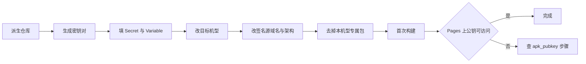
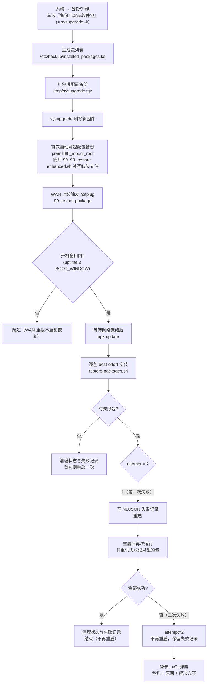
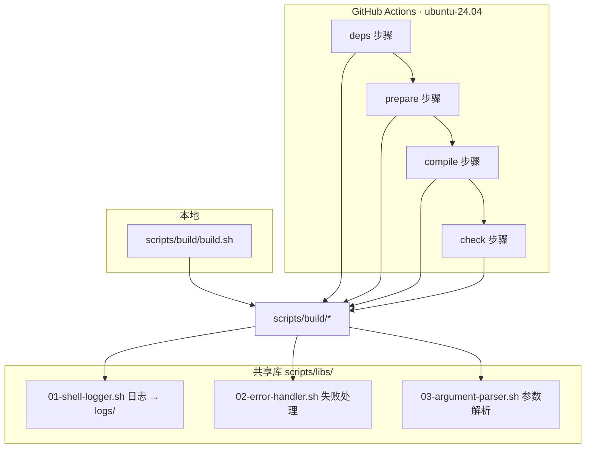

# ImmortalWrt · BPI-R4 固件构建

> 🚀 为香蕉派 **BPI-R4** 路由器自动构建 ImmortalWrt 固件 —— 极简、可自动更新、软件包签名可信。

[](https://github.com/Shuery-Shuai/ImmortalWrt-BPI-R4-Firmware/actions/workflows/immortalwrt-builder.yml)
[](https://github.com/Shuery-Shuai/ImmortalWrt-BPI-R4-Firmware/actions/workflows/syntax-linter.yml)
[](LICENSE)
[](https://openwrt.org/docs/techref/targets)
[](https://github.com/immortalwrt/immortalwrt)
[](.github/workflows/immortalwrt-builder.yml)

## 📖 目录

- [✨ 项目特点](#-项目特点)
- [📦 固件内置组件](#-固件内置组件)
- [🧩 可选扩展包](#-可选扩展包)
  - [📋 软件包变动记录](#-软件包变动记录)
- [🚀 快速开始](#-快速开始)
- [🔐 软件包签名密钥](#-软件包签名密钥)
- [🧳 移植教程：换机型与自建仓库](#-移植教程换机型与自建仓库)
- [🔄 固件更新与软件包恢复](#-固件更新与软件包恢复)
- [🛠 构建系统](#-构建系统)
- [🤝 贡献](#-贡献)
- [📄 许可证](#-许可证)
- [🙏 致谢](#-致谢)

## ✨ 项目特点

|     | 特性                          | 说明                                                                                                                                                                         |
| :-- | :---------------------------- | :--------------------------------------------------------------------------------------------------------------------------------------------------------------------------- |
| 🌱  | **基于 ImmortalWrt 最新源码** | 跟踪上游 `master`，由 Update Checker 每 3 天探测新提交并自动触发构建。                                                                                                       |
| ⚡  | **针对 BPI-R4 硬件优化**      | 目标 `mediatek/filogic`，设备 `bananapi_bpi-r4`，内核配置按该板网口/PWM/USB 能力裁剪。                                                                                       |
| 🎯  | **极简固件**                  | 仅内置基础组件 + Argon 主题 + Nginx；其余功能以可选包（`=m`）形式提供，按需安装。                                                                                            |
| 🔧  | **替换上游默认组件**          | 1. `dropbear` → `OpenSSH`；<br />2. `uhttpd` → `Nginx`。                                                                                                                     |
| 🔁  | **自动更新软件包**            | 升级固件时自动备份已装包列表，重启后由 hotplug 脚本恢复。                                                                                                                    |
| 🔐  | **软件包签名可固定**          | 使用固定 EC P-256 密钥签名仓库，避免升级后出现 `UNTRUSTED signature`。                                                                                                       |
| 🧪  | **CI 与本地同一套脚本**       | 构建逻辑全部在 `scripts/` 下，CI 只是把 stage 拆成几步，本地可完整复现。                                                                                                     |
| 💾  | **升级备份双保险**            | 升级时除官方 `sysupgrade.tgz` 外，另把完整备份落到 eMMC 的 btrfs 分区安全屋并记录条目权限与属主；官方恢复后由 preinit 钩子只补缺失文件。**需勾选「保留配置」**，否则不生效。 |
| 📊  | **失败可诊断**                | 每步日志落 `logs/`，流水线末尾生成运行总结并摘录编译错误行。                                                                                                                 |

> [!WARNING]
>
> - 首次刷机后请**立即修改默认密码**。

<!-- 警告块分隔符 -->

> [!TIP]
>
> - 建议定期备份配置（`/etc/config`）。
> - 如遇网络异常，可先尝试重置防火墙：`fw4 restart`。

## 📦 固件内置组件

| 分类 | 软件包                 | 说明                     |
| :--- | :--------------------- | :----------------------- |
| 界面 | `luci-theme-argon`     | Argon 主题与主题配置界面 |
| 网络 | `luci-nginx`           | Nginx 前端引擎           |
|      | `luci-app-nginx`       | Nginx 前端管理           |
| 语言 | `default-settings-chn` | 中文默认设置包           |

## 🧩 可选扩展包

以下软件包**已编译但未内置**（`.config` 中为 `=m`），可在系统 → 软件包中按需安装：

| 分类     | 软件包                          | 说明                                                 |
| :------- | :------------------------------ | :--------------------------------------------------- |
| 系统管理 | `luci-app-diskman`              | 磁盘管理                                             |
|          | `luci-app-easyupdate`           | 系统简易更新                                         |
|          | `luci-app-rtfwupgrade`          | 路由器固件更新                                       |
| 风扇控制 | `bpi-r4-pwm-fan`                | BPI-R4 PWM 风扇调速守护（直接操作 `/sys/class/pwm`） |
|          | `fan2go`                        | 风扇控制守护                                         |
|          | `luci-app-fancontrol`           | 简易风扇控制                                         |
|          | `luci-app-fanxpert`             | 风扇控制                                             |
| 系统工具 | `zram-swap`                     | 内存压缩交换                                         |
| 网络应用 | `luci-app-dae`                  | 大鹅网络工具                                         |
|          | `luci-app-lucky`                | 大吉内网穿透工具                                     |
|          | `luci-app-openclash`            | OpenClash 代理工具                                   |
|          | `dockerd`                       | Docker 容器引擎                                      |
| 资源下载 | `luci-app-qbittorrent-original` | 原版 qBittorrent 下载器                              |

> [!IMPORTANT]
>
> 风扇控制类包有多个实现（`bpi-r4-pwm-fan` / `fan2go` / `fancontrol` / `fanxpert`），**请只选其中一个安装**。
> 它们都操作同一路 PWM 或 hwmon 接口，同时启用会互相抢控制权。

<!-- 警告块分隔符 -->

> [!NOTE]
>
> **中文字体与 Emoji 字体已预选为模组（`=m`）**：编译进仓库但不内置，
> 需要时在「系统 → 软件包」里安装，不占固件默认体积。
> 包名与原因见下方[📋 软件包变动记录](#-软件包变动记录)。
>
> 四个包合计约 121 MB（三份 CJK 可变字体 116 MB + emoji 4.8 MB），
> 因此**不做内置**；若你确实需要开机即有，把它们在 `.config` 里改成 `=y` 即可。

<!-- 说明块分隔符 -->

> [!TIP]
>
> 大多数软件包安装无需另外支持。
> 若需要其他软件包请在 [Issues](https://github.com/Shuery-Shuai/ImmortalWrt-BPI-R4-Firmware/issues) 中提出。

### 📋 软件包变动记录

只记录**会影响用户安装**的变动（包名变更、不再提供等）。仅影响构建过程、对用户无感的
内部调整不在此列，见 [🛠 构建系统](#-构建系统)。

下表中的新包名都已在本仓库 `.config` 里以 `=m` 预选：编译进仓库但不内置固件，
需要时从「系统 → 软件包」安装即可，无需自行添加 feed。

| 包名                    | 项目                                                                                                | 原因                                                                                                                                                                                                                         |
| :---------------------- | :-------------------------------------------------------------------------------------------------- | :--------------------------------------------------------------------------------------------------------------------------------------------------------------------------------------------------------------------------- |
| `luci-app-argon-config` | 不再单独提供；<br />并入：`luci-theme-argon`                                                        | [immortalwrt/luci][immortalwrt_luci] 已把配置界面合进主题包：主题 Makefile 以 `PKG_PROVIDES:=luci-app-argon-config` 声明该别名。`luci-theme-argon` 本就在 `.config` 里内置（`=y`），配置界面随主题一起装出，无需再单独安装。 |
| `noto-fonts-cjk`        | 改变来源；<br />包名改为：`noto-fonts-cjk-sans`、`noto-fonts-cjk-sans-mono`、`noto-fonts-cjk-serif` | 原引用的第三方仓库 [brainiac19/openwrt-packages][brainiac19_packages] 已删除，改用 [openwrt/packages][openwrt_packages] 官方包（[`50de700`][c-cjk]）。                                                                       |
| `noto-fonts-emoji`      | 改变来源；<br />包名改为：`noto-fonts-color-emoji`                                                  | 原引用的第三方仓库 [brainiac19/openwrt-packages][brainiac19_packages] 已删除，改用 [openwrt/packages][openwrt_packages] 官方包（[`14a26a5`][c-emoji]）。                                                                     |

[immortalwrt_luci]: https://github.com/immortalwrt/luci
[brainiac19_packages]: https://github.com/brainiac19/openwrt-packages
[openwrt_packages]: https://github.com/openwrt/packages
[c-cjk]: https://github.com/openwrt/packages/commit/50de700b0cf97f649116ac667b6015e0d60ae6b3
[c-emoji]: https://github.com/openwrt/packages/commit/14a26a5bfa3f632f9f7d931e36e4ab7f32023943

## 🚀 快速开始

### 直接下载固件

前往 [Releases](https://github.com/Shuery-Shuai/ImmortalWrt-BPI-R4-Firmware/releases) 下载最新构建产物：

```text
ImmortalWrt_firmware_kernel_packages_<device>_<date>.tar.gz   # 内核相关包
ImmortalWrt_firmware_packages_<device>_<date>.tar.gz          # 用户态包
<target>/                                                      # sysupgrade / factory 镜像
```

### 本地构建

```shell
# 完整流程：准备 + 下载 + 编译 + 体积报告
scripts/build/build.sh all

# 或分阶段执行（阶段是累进的：compile 隐含 download 与 prepare）
scripts/build/build.sh deps      # 安装主机依赖（唯一会调用 apt 的阶段）
scripts/build/build.sh prepare   # 克隆源码 / 私钥 / feeds / .config / DIY / defconfig
scripts/build/build.sh download  # prepare + make download
scripts/build/build.sh compile   # download + 编译
scripts/build/build.sh check     # 只统计产物体积，不改动工作区
```

> [!NOTE]
>
> - `deps` **不会**被任何阶段自动触发 —— 本地依赖通常已装好，自动跑 `apt` 既重复又慢。
> - `prepare` 是**幂等**的：它按输入指纹（上游 commit、`.config`、DIY 脚本、`files/`、`libs/` 等）判断，输入没变就跳过。需要强制重跑时设 `FORCE_PREPARE=1`。
> - `REQUIRED=1` 启用严格模式：缺 APK 私钥、缺依赖清单、装依赖失败都直接失败（CI 使用该模式）。

<!-- 警告块分隔符 -->

> [!TIP]
>
> 完整的目录结构、stage 语义、目录划分判据见 **[scripts/README.md](scripts/README.md)**。

### 容器构建

不想在宿主上装几十个编译依赖时，用仓库根的 `docker-compose.yml` 把环境关进容器。它**直接引用**
[`shuery/rtfw-builder`](https://github.com/Shuery-Shuai/rtfw-builder) 镜像，不构建本地镜像：Debian Bookworm + GCC 12 + Clang 18 +
Python 3 + Node.js + Go + `upx`/`padjffs2`/`po2lmo`，容器内用户 `builder`、工作目录 `/home/builder/workdir`。

```shell
# 常驻容器
docker compose up -d builder
docker compose exec builder bash

# 或一次性容器（必须显式给 bash，否则会执行保活命令 sleep infinity 而挂住）
docker compose run --rm builder bash -lc 'scripts/build/build.sh compile'
```

VS Code / Dev Containers 用户可以直接「Reopen in Container」：`.devcontainer/devcontainer.json`用 `dockerComposeFile` 指向同一份
compose 文件，复用同一个服务定义。

> [!IMPORTANT]
>
> - **容器内跳过 `deps` 阶段**。`scripts/build/dependencies.txt` 是按 Ubuntu noble 写的 apt 清单，基线镜像是 Debian Bookworm
>   且已装好全部工具；照着清单再装一遍会让 Debian 源里的 `clang`/`llvm`（14 版）和镜像软链到 `/usr/bin` 的 18
>   版抢同一批路径，直接破坏 BPF 头文件编译。容器内从 `prepare`（或直接 `compile`）开始即可。
> - **工具链由上游门禁保证，本仓库不再重复断言**。`rtfw-builder` 对每次镜像构建都跑
>   `ci/smoke-test.sh`（`gcc >= 10`、`python3 >= 3.8`、Clang 18、GNU 工具链、`upx`/`po2lmo` 等），
>   且发布流程要求「任何路径（含发布）都必须先验证再推送」，冒烟失败的镜像不会发布。
>   因此这里直接引用镜像即可，不需要在 compose 里加一层 healthcheck。
> - 需要完全可复现时改用不可变引用，三种写法等价（改默认值 / 环境变量 / `.env`）：
>
>   ```shell
>   RTFW_BUILDER_IMAGE=shuery/rtfw-builder:bookworm-2026.10.25 docker compose up -d builder
>   RTFW_BUILDER_IMAGE=ghcr.io/shuery-shuai/rtfw-builder@sha256:<digest> docker compose up -d builder
>   ```

## 🔐 软件包签名密钥

固件内置的软件包仓库使用固定的 **EC P-256** 密钥签名，保证设备升级固件后仍信任新构建的仓库，不再出现 `UNTRUSTED signature`。**密钥刻意不随构建轮换**，为的是两件事：

- **没刷本仓库固件的设备，也能稳定用本仓库的软件包**：官方固件或别的固件上的 apk 不认识这个签名，
  手动导入一次公钥（见下方 IMPORTANT）之后就能长期装包；密钥若每次构建重新生成，这次导入就白做。
- **不更新固件，也能更新软件包**：仓库索引始终由同一把私钥签名，设备上已有的公钥一直有效，
  只跑 `apk update` 装包、不刷机，同样不会出现 `UNTRUSTED signature`。

> [!CAUTION]
>
> `private-key.pem` 是包签名的**信任根**，持有者可以签出被本固件信任的 `.apk`。
> **切勿提交到仓库、粘贴到 Issue 或随产物分发。**
> 如需轮换密钥，须同时更新 Secret `APK_PRIVATE_KEY_B64` 与 Variable `APK_PUBLIC_KEY_SHA256`，
> 并通知用户重新导入新公钥；旧私钥对应的公钥仍在设备上被信任，删不回来。

公钥**不再随仓库分发**：`keys/public-key.pem` 已从版本库移除，改由编译期从私钥派生（上游 `rules.mk` 的 `BUILD_KEY_APK_PUB`，由 `package/Makefile` 用
`openssl ec -pubout` 生成），部署时随发布树一起发布到 Pages 并拷入镜像。因此仓库里**没有公钥文件可提交**。

> [!NOTE]
>
> fork 本仓库时必须自带一对密钥才能构建，步骤见 [移植教程 · 第 1 步](#第-1-步准备密钥与仓库设置)。
> 本节其余内容讲的是「密钥如何被使用与信任」，与 fork 无关。

| 位置                                     | 说明                                                   |
| :--------------------------------------- | :----------------------------------------------------- |
| Actions Secret `APK_PRIVATE_KEY_B64`     | 私钥（base64），CI 构建时还原到构建目录                |
| Actions Variable `APK_PUBLIC_KEY_SHA256` | 公钥的 sha256 指纹，用来校验私钥没有漂移               |
| `keys/private-key.pem`                   | 私钥的本地副本，供本地构建使用，已被 `.gitignore` 忽略 |
| Pages `/keys/public-key.pem`             | 唯一公钥地址，构建期派生后随发布树部署                 |
| 镜像 `/etc/apk/keys/public-key.pem`      | 固件内自带的公钥，编译时从派生结果拷入                 |

> [!IMPORTANT]
>
> **刷本仓库固件的设备不需要手动导入公钥。** 公钥是 `base-files` 的普通包文件，
> **既不是 conffile、也不在 `/lib/upgrade/keep.d` 里**；
> sysupgrade 默认走 `build_list_of_backup_config_files`
> （只收 keep 列表与 conffiles），所以这个文件根本不进配置备份——旧系统那份不会被恢复回来，
> 每次刷入新固件，`/etc/apk/keys/public-key.pem` 就是镜像自带的那一份，**公钥随固件自动更新**。
>
> 需要手动导入的只有**没刷本仓库固件**的设备（官方固件或别的固件），它们要用本仓库的软件包：
>
> ```sh
> wget -O /etc/apk/keys/public-key.pem https://immortalwrt.shuery.lssa.fun/keys/public-key.pem
> apk update
> ```
>
> 这类设备导入一次即可长期使用：密钥固定不轮换，仓库索引始终由同一把私钥签名，
> 所以**不刷固件也能持续 `apk update` 装包**。apk 会信任 `/etc/apk/keys/` 下的所有密钥，新旧公钥可共存。

### 门禁如何校验密钥

基准指纹有两块来源，取值链与私钥一致：环境变量 `APK_PUBLIC_KEY_SHA256`（CI 的 Variable）优先，
缺失时回退到本地 `keys/public-key.pem` 的 sha256（与本地直接读 `keys/private-key.pem` 同一思路）。

| 场景                             | 基准来源     | 结果                                                |
| -------------------------------- | ------------ | --------------------------------------------------- |
| CI（Variable + Secret）          | Variable     | 正常校验私钥派生出的公钥                            |
| 本地（有 `keys/public-key.pem`） | 本地公钥文件 | 直接通过，无需配 Variable                           |
| 两者都有但指纹不同               | Variable     | 通过，但**警告本地密钥已漂移**                      |
| 两者都没有                       | —            | CI 硬失败；本地降级为告警，用一次性密钥也能编出固件 |

本地公钥因此不再是只写不读的死文件：它既用来算基准，也让本地与 CI 走同一条校验路径。
fork 时如何从零生成这对密钥，见 [移植教程 · 第 1 步](#第-1-步准备密钥与仓库设置)。

## 🧳 移植教程：换机型与自建仓库

本仓库是**为 BPI-R4 定制**的构建仓库，不是通用模板：目标设备、软件源域名与专属软件包都写死在仓库里。移植分两类，可以只做其中一类：

- **换机型**：沿用本仓库的 Pages 与密钥，只把目标设备换成你自己的板子。
- **自建仓库**：把整套流程搬到自己的仓库，域名、密钥、机型一起换掉。



### 第 1 步：准备密钥与仓库设置

**这一步必须最先做**：CI 的 job 第一步就是密钥门禁，密钥没配好会在编译开始前失败，
此时改机型没有任何意义。

本仓库**不含任何密钥文件**，fork 后必须生成自己的密钥对。整个过程只做一次（EC P-256，与上游
`BUILD_KEY_APK_SEC` / `BUILD_KEY_APK_PUB` 一致），命令与 `scripts/ci/check-apk-signing-key.sh`
缺变量时打印的指引逐字相同：

```sh
mkdir -p keys
openssl ecparam -name prime256v1 -genkey -noout -out keys/private-key.pem
openssl ec -in keys/private-key.pem -pubout -out keys/public-key.pem
base64 -w0 keys/private-key.pem                  # → Secret   APK_PRIVATE_KEY_B64
sha256sum keys/public-key.pem | awk '{print $1}' # → Variable APK_PUBLIC_KEY_SHA256
```

命令请在**仓库根**执行：`mkdir -p keys` 是相对仓库根的路径，两个生成物都落在 `keys/` 下
（`keys/private-key.pem` 正是本地构建缺省查找的位置）。这两个文件已被 `.gitignore` 忽略，
但入库与否最终由你负责：执行完用 `git status --short` 确认里面**看不到**它们，再 `git add`。

> [!CAUTION]
>
> `keys/private-key.pem` 与 `keys/public-key.pem` **都不要入库**：二者都在 `.gitignore` 里，
> 且公钥由构建期从私钥派生，提交进来反而多一份要同步的信任锚副本。

拿到两串值后，在本仓库 **Settings → Secrets and variables → Actions** 里添加：

| 类型     | 名称                    | 用途                                          |
| :------- | :---------------------- | :-------------------------------------------- |
| Secret   | `APK_PRIVATE_KEY_B64`   | 包签名私钥；缺了它镜像会改用一次性密钥        |
| Variable | `APK_PUBLIC_KEY_SHA256` | 公钥指纹；缺了它 CI 在门禁处直接失败          |
| Secret   | `ACTIONS_TRIGGER_PAT`   | 定时巡检发现上游新提交后，派发 Builder 需要它 |

`ACTIONS_TRIGGER_PAT` 与密钥无关，是 `update-checker` 派发 Builder 用的；密钥两项缺一会怎样、
轮换为什么有代价，见 [🔐 软件包签名密钥](#-软件包签名密钥)。

> [!NOTE]
>
> Pages 的自定义域名**不在仓库里**（仓库内没有 `CNAME` 文件），它配置在仓库
> Settings → Pages 中。换域名时两处都要改：Pages 设置里改域名，`customfeeds.list` 里改 URL。

#### 两个 feeds 文件的分工

| 文件                                       | 谁负责                      | 内容                                            | 体检脚本是否处理           |
| :----------------------------------------- | :-------------------------- | :---------------------------------------------- | :------------------------- |
| `/etc/apk/repositories.d/distfeeds.list`   | 发行版构建时生成            | 官方/官方镜像源，设备上指向 `mirrors.vsean.net` | **是**：注释取不到索引的行 |
| `/etc/apk/repositories.d/customfeeds.list` | 用户（本仓库 Pages 自建源） | `immortalwrt.shuery.lssa.fun` 等自建源          | **否**：从不读写           |

`replace-apk-source.sh` 的边界是 distfeeds：自定义源的地址对不对、要不要换，只有用户知道，
脚本没有判断依据，也不该替用户做这个决定。

脚本在**重启后首次接通 WAN** 时执行一次（`/etc/hotplug.d/iface/88-replace-apk-source`，
用 `/tmp/.replace-apk-source.done` 标记确保一个启动周期只跑一次；WAN 重拨不会重复执行，
执行失败会清除标记以便下次重试）。

它按固定顺序做三件事：

| 步骤    | 做什么                                                           | 为什么在此时                   |
| :------ | :--------------------------------------------------------------- | :----------------------------- |
| 1. 测速 | 删索引缓存 → 计时 `apk update` → 缓存增量算速度                  | 必须在换源前，否则没有比较基准 |
| 2. 换源 | 候选用 `--cache-dir` 隔离测速，快 `SWITCH_GAIN_RATIO` 倍以上才换 | 必须在注释前，见下             |
| 3. 注释 | 用 `apk update` 真实失败输出判定，加 `# 404:` 前缀               | 换完后 URL 已是最终地址        |

**顺序不能颠倒**：若先注释再换源，被注释行里的旧 URL 会被 `sed` 一并替换，
`# 404: https://旧源/...` 变成 `# 404: https://新源/...`——那行失效记录就指向了一个
其实可用的地址，下次再也无法正确恢复。设备实测验证过：换源后注释行确实指向新域名。

换源门槛（默认 1.5 倍）是刻意的：两个镜像都能用时来回换，每次改动都触发索引重下，
比一直用慢的那个更糟。`SKIP_MIRROR_SWITCH=1` 只测速不换源，`SKIP_SPEED_TEST=1` 跳过测速。

换源门槛是刻意加的：两个镜像都能用时来回换，每次改动都触发一次索引重下，
比一直用慢的那个更糟。`SKIP_MIRROR_SWITCH=1` 可只测速不换源。

镜像池分两套，**绝不跨套替换**——OpenWrt 与 ImmortalWrt 的仓库内容不同，
混用会装到错误的软件包（同名包在两边版本、依赖都可能不一样）：

```bash
OPENWRT_MIRRORS=(
    "https://downloads.openwrt.org/snapshots"          # 157 KB/s
    "https://mirrors.ustc.edu.cn/openwrt/snapshots"    # 130 KB/s
)

IMMORTALWRT_MIRRORS=(
    "https://downloads.immortalwrt.org/snapshots"      # 105 KB/s
    "https://mirrors.vsean.net/openwrt/snapshots"      # 442 KB/s（mesa）
    "https://immortalwrt.kyarucloud.moe/snapshots"     #  84 KB/s
)
```

**镜像池刻意精简**：每个镜像每次运行只实测一次，单次样本噪声很大——
实测同一对镜像的比值在 1.48～1.56 之间波动。池子越大，"挑最快的"越接近掷骰子。
因此只保留少量可靠镜像，而不是把知道的都堆进来。

> [!NOTE]
>
> 清华 TUNA **当前不提供 OpenWrt 镜像**（`/openwrt/` 返回 403，`snapshots` 返回 404），
> 因此不在池内。加入前必须实测能拉取整套索引。

数组元素是**到 `/snapshots` 那一层为止**的完整前缀，不含 `targets/` 与 `packages/`：
少写一层会拼出 404 的 URL，候选被误判成"不可用"。

镜像归属用显式分组判定，不靠域名猜：`mirrors.vsean.net/openwrt` 的路径里带 `openwrt`，
但它提供的是 ImmortalWrt 快照，按关键字归类会分错。

设备实测（2026-11，三次平均，整套 7 个索引共 4.2 MB）：

| 源                               |     平均速度 | 所属池      |
| :------------------------------- | -----------: | :---------- |
| `mirrors.pku.edu.cn/immortalwrt` | **682 KB/s** | ImmortalWrt |
| `mirrors.vsean.net/openwrt`      |     442 KB/s | ImmortalWrt |
| `downloads.openwrt.org`          |     157 KB/s | OpenWrt     |
| `mirrors.ustc.edu.cn/openwrt`    |     141 KB/s | OpenWrt     |
| `downloads.immortalwrt.org`      |     105 KB/s | ImmortalWrt |
| `immortalwrt.kyarucloud.moe`     |      84 KB/s | ImmortalWrt |

脚本会在同池内逐个实测，挑最快的那个；只有比当前快 `SWITCH_GAIN_RATIO`（默认 1.5）倍以上才真正替换。

#### 与恢复脚本的协作

两个 hotplug 脚本都监听 WAN ifup，必须串行而不是并行：

```text
WAN up ──┬─> 88-replace-apk-source: 写 running → 测速 → 换源 → 注释 → 写 ready
        └─> 99-restore-package: 依据 running/ready ──> restore-packages.sh
```

**关键设计：由换源脚本主动声明状态，而不是让恢复脚本去猜。**
"脚本文件存在"不等于"它会跑"——hotplug 目录可能没被装进来、被用户删了、
或固件裁剪掉了换源脚本。恢复脚本无从区分"还没开始"和"永远不会开始"，
只能靠超时，而超时会白白拖慢每一次开机。

两个状态文件都在 `/tmp`（tmpfs，重启即消失）：

| `running` | `ready` | 恢复脚本的判断                                | 实测耗时 |
| :-------- | :------ | :-------------------------------------------- | -------: |
| 无        | 无      | 本机没有换源机制 → 立即开工                   |      8 s |
| 有        | 无      | 正在处理 → 等它（`SOURCE_STUCK_WAIT` 后兜底） |     按需 |
| 任意      | 有      | 已结束 → 立即开工                             |      0 s |

8 秒的宽限期是必要的：两个脚本都在 WAN ifup 时被拉起，谁先执行并不确定，
必须给换源脚本一点时间先写下 `running`。换源脚本若很快结束并写 `ready`，
恢复脚本下一轮轮询就能立刻看到，不会真等满 8 秒。

换源脚本无论成败都会写 `ready` 并清掉 `running`——源检查失败时，
"用现有配置去装包"至少还有机会成功，让恢复永远等下去则什么也做不成；
失败时清掉 `running`，下次 ifup 才能重试。

#### 恢复只在"本次开机第一次联网"时执行

旧实现按 `BOOT_WINDOW=900`（开机 15 分钟内）判断，这在慢设备上是真实故障：
eMMC 上电、btrfs 挂载、PPPoE 重协商常常超过 15 分钟，于是**恢复一次都不会发生**。

现在改用 `/tmp/.restore-packages.done` 标记：
本次开机跑过就不再跑，重启后文件消失自然重置。
只保留一个很宽松的硬上限 `RESTORE_MAX_UPTIME`（默认 21600 秒 = 6 小时），
用来兜住"标记被误删且设备已跑很久"的极端情况。

### 第 2 步：改目标机型（必改）

目标平台由仓库根的 `.config` 决定（`prepare` 阶段把它复制成 `immortalwrt/.config`）。真正要动的只有下面 6 行，命名规律是
`CONFIG_TARGET_<board>_<subtarget>[_DEVICE_<device>]`：

```dotenv
# 以 qualcommax/ipq807x 为例：替换原来的 mediatek/filogic + bananapi_bpi-r4
CONFIG_TARGET_qualcommax=y
CONFIG_TARGET_qualcommax_ipq807x=y
CONFIG_TARGET_qualcommax_ipq807x_DEVICE_your_device_id=y
CONFIG_TARGET_BOARD="qualcommax"
CONFIG_TARGET_SUBTARGET="ipq807x"
CONFIG_TARGET_PROFILE="DEVICE_your_device_id"
```

设备 ID 不要猜，直接从上游的设备定义里查（`prepare` 跑完 `immortalwrt/` 才存在）：

```shell
grep '^define Device/' immortalwrt/target/linux/<board>/image/<subtarget>.mk
```

也可以 `cd immortalwrt && make menuconfig` 点选目标后，把生成的 `.config` 里这几行抄回仓库根。第 8 行 `CONFIG_TARGET_ROOTFS_PARTSIZE=796` 是
BPI-R4 的分区大小，新机型按自己的存储改，或整行删掉用上游默认值。

### 第 3 步：改签名源（换域名或换架构必改）

`files/etc/apk/repositories.d/customfeeds.list` 把本仓库的 Pages 地址硬编码进 7 行（含 3 行注释），要换两处：域名，以及 `targets/<board>/<subtarget>`
与 `packages/<arch>` 两段路径。

```shell
sed -i 's|immortalwrt\.shuery\.lssa\.fun|<你的 Pages 域名>|g' \
    files/etc/apk/repositories.d/customfeeds.list
sed -i 's|aarch64_cortex-a53|<你的目标架构>|g' \
    files/etc/apk/repositories.d/customfeeds.list
```

> [!TIP]
>
> 架构值**不在**仓库根的 `.config` 里：它由 `make defconfig` 按目标推导。先跑一次
> `scripts/build/build.sh prepare`，再 `grep '^CONFIG_TARGET_ARCH_PACKAGES' immortalwrt/.config` 读回来。

### 第 4 步：去掉本机型专属的东西

下列内容只对 BPI-R4 有意义，换机型时应当移除，否则会多打包一个用不上的守护进程，或对错误的 DTS 做分区手术：

| 位置                                          | 内容                                                  | 处理                                   |
| :-------------------------------------------- | :---------------------------------------------------- | :------------------------------------- |
| `scripts/inputs/diy-part1.sh`（第 33–36 行）  | `clone_repo` 引入 `bpi-r4-pwm-fan`（PWM 风扇守护）    | 删掉或注释这条 `clone_repo`            |
| `.config`（第 82 行）                         | `CONFIG_PACKAGE_bpi-r4-pwm-fan=m`                     | 删掉，或换成你机型对应的风扇包         |
| `scripts/inputs/mods/12-modify-partition.sh`  | 只认 `mediatek/image/filogic.mk` 与 `bananapi_bpi-r4` | 保持不启用（调用处已注释，见第 26 行） |
| `scripts/ci/generate-summary.sh`（第 160 行） | 运行总结标题写死「ImmortalWrt BPI-R4 构建总结」       | 改成你的机型；纯展示，不影响构建       |

> [!TIP]
>
> `scripts/inputs/mods/` 下的其它 mod（默认 IP、默认 Shell、LuCI 集合补丁、Rust 配置、
> libnl-tiny 修复等）与机型无关，可以原样保留。

### 第 5 步：换源码分支（可选）

默认跟踪 ImmortalWrt 的 `master`。换上游（例如改回 OpenWrt 官方，或钉在某条分支）时两个workflow 都要改 —— `update-checker` 用同一对变量判断上游有没有新提交：

```yaml
# .github/workflows/immortalwrt-builder.yml（第 29–30 行）
# .github/workflows/update-checker.yml（第 15–16 行）
REPO_URL: https://github.com/immortalwrt/immortalwrt
REPO_BRANCH: master
```

脚本侧有同名默认值兜底（`scripts/build/pipeline.sh`），因此只改 workflow 也能生效。

### 第 6 步：首次构建与验证

推送后手动跑一次 **ImmortalWrt Builder**（Actions → Run workflow），再按下表核对：

| 检查项           | 做法                                              | 期望结果                 |
| :--------------- | :------------------------------------------------ | :----------------------- |
| 目标机型生效     | `grep '^CONFIG_TARGET' immortalwrt/.config`       | 六行都指向你的目标       |
| 密钥门禁通过     | 看 job 第 5 步 `Verify apk signing key`           | 绿；红则回到第 1 步      |
| 公钥已进产物     | 看 `Publish apk public key into bin`              | 绿；红说明没派生出公钥   |
| Pages 公钥可访问 | `curl -sI https://<你的域名>/keys/public-key.pem` | `200`                    |
| 设备能从仓库装包 | 刷入新固件后直接跑 `apk update`                   | 无 `UNTRUSTED signature` |

> [!CAUTION]
>
> 移植后首次刷入的固件就是「自带你的公钥」的那一版：公钥作为 `base-files` 包文件随镜像下发，
> 刷完即生效，**不需要手动导入**；之后更换密钥也只是再刷一次新固件。
> 真正的风险在**别人**身上：沿用旧仓库（或从旧仓库迁移）的设备上留着旧公钥，你的新私钥签出的包
> 会被它们拒绝。这不受本教程控制，只能通过通知用户重新导入公钥来兜底，见
> [🔐 软件包签名密钥](#-软件包签名密钥) 的 IMPORTANT 块。

### 不用改的部分

以下内容与机型无关，移植时不要动，动了只会引入风险：

- `scripts/libs/`、`scripts/build/steps/`、`scripts/ci/check-apk-signing-key.sh`：通用能力。
- CI 的分步结构与 `STEP_SEQUENCE`：artifacts、Release、Pages 都靠它对齐。
- 产物命名：`DEVICE_NAME` 由 `grep '^CONFIG_TARGET.*DEVICE.*=y' immortalwrt/.config` 自动推导
  （见 `.github/workflows/immortalwrt-builder.yml` 第 216 行），改完 `.config` 它会自己跟上。

## 🔄 固件更新与软件包恢复

固件在升级时会记录已安装的用户软件包，重启后自动恢复。恢复采用**两阶段策略**：第一次全量安装，失败则重启一次；重启后只重试失败包；二次仍失败就不再重启，改为登录 LuCI 时弹窗提示，把问题交给人处理，绝不陷入重启循环。

### 单轮内的即时重试

状态机的第二轮要等**整机重启**才发生，一次网络抖动就可能白白消耗掉这次机会。因此安装阶段内部还有一层更廉价的重试，把瞬时故障就地消化：

| 位置                      | 重试次数                       | 间隔                                  | 说明                                   |
| :------------------------ | :----------------------------- | :------------------------------------ | :------------------------------------- |
| `apk update`              | `APK_UPDATE_RETRIES`（默认 2） | `APK_UPDATE_RETRY_BACKOFF`（默认 5s） | 索引是逐包安装的前提，没索引会成片失败 |
| `apk add`（fetch 类失败） | `APK_ADD_RETRIES`（默认 1）    | `APK_ADD_RETRY_BACKOFF`（默认 3s）    | 只对下载中断/镜像临时不可用重试        |

`package_not_found`（包不存在）是**确定性**失败，同一轮内重试必然得到同样结果，因此立刻放弃，不浪费等待时间。

重试配置有上限保护（次数最多 5、间隔最多 60 秒），非法值回落默认值而不是让脚本在比较处崩溃。日志里会单独统计「第 2 次尝试才装成功」的包数——这个数字持续大于 0 说明镜像不稳定，比单纯看失败数更能定位环境问题。

**是否重启只由一个条件决定：本轮有没有真的装上新包**（`apk add` 成功，已安装而跳过的不算）。
一个包都没装上时重启毫无意义——磁盘状态没变，重启只会让用户多等一次；因此"全部已安装跳过"
和"全部安装失败"这两种情况都不会重启，后者直接写失败记录等 LuCI 提示。



### 状态机与文件

| 文件                                      | 作用                                                                |
| ----------------------------------------- | ------------------------------------------------------------------- |
| `/etc/backup/installed_packages.txt`      | sysupgrade 生成的原始包列表，格式 `包名<TAB>rom\|overlay\|unknown`  |
| `/etc/backup/restore_pkg.state`           | 尝试状态，扁平 `key=value`：`attempt`（0/1/2）、`stage`、`last_run` |
| `/etc/backup/restore_pkg_failures.ndjson` | 失败记录，**扁平 NDJSON**，每行一个独立 JSON 对象，追加写入         |
| `/etc/backup/restore_pkg_notices.ndjson`  | 提醒记录（如包已更名），独立文件，不参与重试与状态判定              |

`attempt` 语义：已完成的安装轮次计数。

| 场景                       | attempt | 是否重启             | 后续                 |
| -------------------------- | ------- | -------------------- | -------------------- |
| 一次全量安装全部成功       | 清理    | 是（装上了包）       | 结束                 |
| 全量时所有包"已安装"跳过   | 清理    | 否（没装任何包）     | 结束                 |
| 第一次有失败包（有装上的） | 1       | **是**               | 重启后只重试失败包   |
| 第一次全部失败（一个没装） | 2       | **否**               | 直接留失败记录       |
| 二次重试全部成功           | 清理    | 是（补装的包需生效） | 结束                 |
| 二次重试仍有失败           | 2       | **否**               | 登录 LuCI 弹窗提示   |
| `attempt=2` 且失败记录仍在 | 2       | **否**               | 直接退出，防重启循环 |

重启判据是「本轮真实安装数 > 0」，不是「第几轮」。因此**装不上包时绝不重启**，
而每次确实装上了包都会重启一次让它生效——重启次数由"有没有装到东西"决定，
但状态机保证 `attempt` 最多推进到 2，仍不可能出现重启循环。

### 失败记录格式（NDJSON）

每行一个对象，无数组包裹、无嵌套。公共字段：

| 字段                   | 说明                                          |
| ---------------------- | --------------------------------------------- |
| `schema`               | 固定 `openwrt-apk-failure/1`                  |
| `ts` / `host` / `arch` | 时间、主机名、架构                            |
| `stage`                | `fetch`（下载/索引）或 `resolve`（选择/解析） |
| `error_class`          | `fetch_error` 或 `package_not_found`          |
| `message`              | 单行错误摘要                                  |
| `package`              | 本轮实际失败的包名（下一轮就重试它）          |
| `attempt`              | 本轮 attempt（1 或 2）                        |

按错误类型追加：

| error_class         | 追加字段                                                                      |
| ------------------- | ----------------------------------------------------------------------------- |
| `fetch_error`       | `tool`、`exit_code`、`target`、`related_warning`                              |
| `package_not_found` | `missing_packages`（字符串数组）、`required_by`（与前者平行）、`likely_cause` |

> [!NOTE]
>
> `WARNING`（如 `unexpected end of file`）**不单独记成失败事件**，
> 只作为 `related_warning` 挂到对应的 `fetch_error` 上。
> 判定顺序是「先查 fetch 特征，再查 resolve 特征」——索引没下载下来时 apk 也会打印
> `unable to select packages`，顺序反了会把网络问题误报成「包不存在」。

### 无 jq 环境下的提取

OpenWrt 上可能没有 jq，或 jq 功能残缺。失败记录特意设计成**扁平 + 数组只装字符串 +逗号后无空格**，因此用 `sed`/`tr` 就能提取：

```sh
# 取每条记录的 error_class
sed -n 's/.*"error_class":"\([^"]*\)".*/\1/p' /etc/backup/restore_pkg_failures.ndjson

# 取包名，每行一个
sed -n 's/.*"missing_packages":\[\([^]]*\)\].*/\1/p' /etc/backup/restore_pkg_failures.ndjson \
  | tr ',' '\n' | tr -d '"' | sed '/^$/d'
```

> [!NOTE]
>
> 这套 `tr` 方案能处理的包名字符集是 apk 实际使用的 `[a-z0-9.+-]`。
> 含逗号或引号的异常包名会被 `tr` 劈开，因此脚本生成数组时会过滤掉非法字符并记 WARN。

### 包名变动处理（更名与合并）

旧包名若照常安装，会先失败、触发一次**毫无意义的重启**，最后弹一句"包可能已更名"的推测。
为此脚本在安装前按对照表（`_renamed_replacement`）就地改写安装清单，既不重试也不重启。

对照表只登记上游确实变动过的包，**两类走不同策略**：

| 旧包名                  | 现状                                                                                    | 处理             |
| :---------------------- | :-------------------------------------------------------------------------------------- | :--------------- |
| `noto-fonts-cjk`        | 拆分为 `noto-fonts-cjk-sans`、`noto-fonts-cjk-sans-mono`、`noto-fonts-cjk-serif` 三个包 | 三个全部安装     |
| `noto-fonts-emoji`      | 改名为 `noto-fonts-color-emoji`                                                         | 自动改用新名安装 |
| `luci-app-argon-config` | 并入 `luci-theme-argon`（别名）                                                         | 自动丢弃该项     |

三类策略分别由 `_removed_package`（移除）、`_renamed_replacement`（改名）、`_rename_is_alias`（合并）实现：

- **移除**：旧名被上游彻底删除且没有替代包，直接跳过并记一条 `removed_package`。这类包照常安装只会得到
  `package_not_found`，白白消耗一次整机重启，而它根本没有新名可换。
  该表**默认为空**，只登记亲眼确认过的移除项——网上流传的清单混着改名与临时下架，
  照抄会把本该能装的包当成移除丢掉，等于悄悄削减用户能力。
- 表默认空意味着：未登记的包仍走正常的失败提示路径，宁可多弹一次窗，也不猜。

对照表的改写**只作用于本轮临时清单**（`/tmp/restore-pkg-work.$$`），
原备份文件保持只读，且发生在 `apk update` 之前——索引都是按最终包名拉取的。

> [!NOTE]
>
> **改名 → 自动换新名安装**：新名在 feed 里能装到，替用户装好即可，不必让他再手动来一次。
> 一个旧目录拆成多个包时**全部安装**：`noto-fonts-cjk` 产出 `-sans` / `-sans-mono` / `-serif`
> 三个包，三者的 install 段各自装不同字体文件（常规、等宽、衬线），少装一个就少一种字形。
> 对照表里用空格分隔的多个包名因此会被逐个写进安装清单。
>
> **合并 → 自动丢弃**：`luci-app-argon-config` 只是 `PKG_PROVIDES` 声明的别名，
> 功能已并入 `luci-theme-argon`，而后者本就在 `.config` 里内置。此时再装一遍旧名没有意义，
> 因此直接从清单里丢掉，只留一条 `merged_package` 说明。
>
> 两者都**不会**让用户以为安装失败——它们进的是提醒记录，不是失败记录。

提醒写入独立文件 `/etc/backup/restore_pkg_notices.ndjson`，字段：

| 字段                      | 说明                                                         |
| :------------------------ | :----------------------------------------------------------- |
| `schema`                  | 固定 `openwrt-apk-notice/1`                                  |
| `category`                | `renamed_package`（已换名安装）或 `merged_package`（已丢弃） |
| `package` / `replacement` | 旧包名 / 新包名（多个时以空格分隔）                          |
| `message`                 | 展示给用户的一行说明；**不拼接新包名**，见下方说明           |

生成页面数据时两份文件会被合并，但**职责严格分开**：失败记录进 `packages`（失败包名清单）
与 `entries`；提醒记录只进 `entries`，并额外带 `legacy` 字段承载旧包名。
前端据此把旧名与新名都按行内代码块渲染，因此「已更名」不会被算进失败数或"受影响的包"。

**为什么与失败记录分开存**：混在一起会同时踩两个坑——`failure_count > 0` 会让状态机
进入"二次失败终态保护"，把一次正常恢复锁死；而全部安装成功时 `state_clear` 会整份删除
失败记录，提醒随之消失。

提醒会自动过期：每次运行先执行 `_prune_resolved_notices`，把"新包已经装好"的条目录删掉，
全部过期时连文件一起删除。因此**不需要用户手动清理**。

> [!TIP]
>
> 改名类的提醒通常会被下一次运行立刻清掉——因为清单改写后新名当场就装上了。
> 这不是缺陷：提示的作用是解释"为什么备份里的包名变了"，看过一次就够。
>
> 一个旧目录拆成多个包时，判据是**全部装好**才算过期：只看第一个会在其余几个
> 还没装时就误删提醒，用户于是失去"当初那个包该换成什么"的唯一线索。

### 失败提示（LuCI）

二次尝试仍失败后，脚本不再重启，并保留失败记录。用户登录 LuCI 时会出现一个**可关闭的浮层**，内容包含：失败包名清单、每类失败的原因（`fetch_error` 表示镜像/网络或索引下载不完整；`package_not_found`
表示仓库索引缺失或包名不存在）、以及对应的大致解决方案。

注入到 LuCI 模板的是一整个 ucode 模板块（``，可跨行书写），
构建期按「锚点后 payload 行数逐行比对」校验注入结果，载荷被截断或多插都会让构建失败。

**已更名/已合并不算失败**：两类提醒只进提醒记录，浮层里单列「变更内容」小节，
旧名与新名都以行内代码块显示（例如 `noto-fonts-cjk` 已更名为
`noto-fonts-cjk-sans`、`noto-fonts-cjk-sans-mono`、`noto-fonts-cjk-serif`），
标题与导语也不会因为存在这些提醒就说"恢复失败"。

| 操作       | 说明                                                                        |
| ---------- | --------------------------------------------------------------------------- |
| 关闭提示   | 点「我知道了」、右上角 ✕、按 Esc，或点遮罩空白处                            |
| 不再重复弹 | 关闭后按内容指纹记入浏览器 `localStorage`；同一内容不再弹，内容变化才重新弹 |
| 想重试恢复 | 删掉状态文件与失败记录后手动执行，或 `restore-packages.sh --force`          |

```sh
rm -f /etc/backup/restore_pkg.state /etc/backup/restore_pkg_failures.ndjson
/usr/bin/restore-packages.sh -c
```

处理建议：

- `fetch_error`：检查设备能否上外网、软件源镜像是否可达；必要时换镜像，
  然后 `apk update` 确认索引完整下载，再重试。
- `package_not_found`：检查「系统 → 软件包 → 配置」里的软件源是否包含所需仓库；
  确认包名是否已更名/合并/移除；执行 `apk update` 拉取完整索引。

> [!WARNING]
>
> - 手动更新固件时，请在更新选项中**勾选「备份已安装软件包」**。
> - 更新完成后系统将自动恢复之前安装的软件包，**恢复过程中请勿断电或重启**。

<!-- qBittorrent 升级保存路径：与上方 WARNING 分开，避免两个 alert 被 markdownlint 视为同一引用块 -->

> [!IMPORTANT]
>
> 使用 `qbittorrent-original` 时，需将 `/etc/qbittorrent` 加入系统升级保存列表。
> 编辑 `/etc/sysupgrade.conf` 添加：
>
> ```conf
> /etc/qbittorrent/
> ```

### 增强备份与恢复

官方 sysupgrade 的配置备份存在偶发漏文件、目录权限元数据不保留的问题。本机制在官方流程之外再加一层
保险：升级时多打一份完整归档，升级后首次启动把官方漏掉的文件补齐。它**不修改官方脚本**，只通过
`/lib/upgrade` 与 `/lib/preinit` 两个钩子目录扩展。

#### 安全屋位置与探测链

安全屋目录固定为 `<挂载点>/backup-enhanced`。探测顺序是：`/boot` → `/recovery` →
`mount` 输出中 `/dev/mmcblk0p1` 的挂载点 → `/opt`（p8 已挂好的情况）→ 仅恢复阶段多一步
自挂载 `/dev/mmcblk0p8`（只读挂到临时目录，拷完即卸）。

前三个候选是给真有 `/boot` 或 `/recovery` 的板子留的顺序，**本机型（BPI-R4）上它们必然落空**：

- `/dev/mmcblk0p1` 是裸 eMMC boot blob（首扇区 `SDMMC_BOOT`，GPT 名 `bl2`），挂不上；
- `/boot` 与 `/recovery` 不存在；
- p5 / p6 是 FIT 分区，不能当存储。

真正可用的是 `/dev/mmcblk0p8`（btrfs，平时挂 `/opt`）：fitrw 的 f2fs overlay 与 squashfs 同属
`mmcblk0p7`，升级时会被重写，只有 p8 幸存。备份阶段只认已挂载的 `/opt`（升级前它本来就在）；
恢复阶段若 `/opt` 还没挂上，钩子会自己只读挂载 p8，把三件套拷进 tmpfs 后立即卸载。

三件套：

| 文件                     | 用途                                                                                                                    |
| :----------------------- | :---------------------------------------------------------------------------------------------------------------------- |
| `backup-enhanced.tar.gz` | 归档本体，内容来自官方备份清单                                                                                          |
| `filelist-enhanced.txt`  | `sysupgrade --list-backup` 的原始清单，恢复时用来对照                                                                   |
| `meta-enhanced.txt`      | 每行 `mode uid gid path` 的权限与属主记录；**条目数比清单多**，因为额外记录了每个文件的父目录（清单只有文件、不含目录） |

#### 与官方流程的衔接

备份阶段：`/sbin/sysupgrade` 执行 `include /lib/upgrade` 时会 source 本脚本，脚本在 source 期把
`backup_enhanced_hook` 追加进 `sysupgrade_init_conffiles`，于是 `create_backup_archive()` 里的
`run_hooks` 会调用它——官方备份照常生成，增强归档是额外产物。

恢复阶段：`99_90_restore-enhanced.sh` 用 `boot_hook_add preinit_main` 注册钩子。文件名取
`99_90_` 前缀是为了排在 `80_mount_root` 之后：`/etc/preinit` 按文件名通配 source
`/lib/preinit/*`，钩子按注册顺序 FIFO 执行，而官方配置恢复写在 `80_mount_root` 的
`do_mount_root()` 里。

#### 冲突避免三条

- 时机：恢复钩子晚于官方 `do_mount_root`，官方恢复已经跑完，这里看到的才是「官方漏了什么」。
- 内容：只补缺失，**已存在的路径完全不碰**。做法是先 `tar -tzf` 取归档成员，只把当前不存在的
  路径写进 `-T` 列表再解包。不用 `tar -x -k` 的原因：BusyBox 的 `-k` 遇到第一个已存在文件会
  整体中止并返回非 0，后面本该补齐的文件全部丢失。
- 权限：先比对再修正。逐条读 `meta-enhanced.txt`，与当前 `ls -ldn` 结果一致就跳过并记日志，
  只在不一致时 `chmod` / `chown`。

#### 前提条件

> [!IMPORTANT]
>
> **升级时必须勾选「保留配置」（不要用 `sysupgrade -n`）。** 不保留配置就不会生成
> `/sysupgrade.tgz`，恢复钩子的闸门判定为 idle，连安全屋都不会去探测，增强备份整条链路不生效。

#### 已知限制

- 升级后首次开机的 btrfs 依赖本脚本自行 `modprobe`。上游 `base-files` 的
  `/lib/preinit/78_btrfs_scan_pre` 是 `85_btrfs_scan_post` 的符号链接，两者被 `/etc/preinit`
  通配 source 时会各 source 一次，把同一个 `preinit_btrfs_scan` 注册两次；`boot_run_hook` 的
  `PI_RAN_` 去重让它在 78 的位置（`80_mount_root` 之前）先跑，那时 btrfs 模块还没加载，
  `grep -q btrfs /proc/filesystems` 为假而静默跳过，85 想要的「挂载后做 btrfs device scan」
  因此永不发生。这是既有缺陷，本机制未修。
- 安全屋是唯一副本，p8 损坏即全丢。
- setuid / setgid / sticky 位只统计并记日志，不恢复。
- 跳过日志默认只记前 20 条，以免冲掉 64K 环缓冲；`RESTORE_ENHANCED_VERBOSE=1` 可全量输出。
- 恢复钩子在 preinit 阶段自挂载 p8 时用只读方式，并在子 shell 里用 `trap` 保证卸载：若遗留挂载，
  fstools 的 `block mount` 会误判 `/opt` 已挂载而直接跳过，导致该次启动没有 `/opt`。

#### 日志

标签 `backup-enhanced` / `restore-enhanced`，用 `logread -e backup-enhanced` 查看。

恢复闸门的判定条件是 `/sysupgrade.tgz` 或 `/tmp/sysupgrade.tar` 存在；手工测试时可
`touch /tmp/.restore-enhanced-force`，或在安全屋里放 `.restore-enhanced-trigger` 强制触发一次
（后者只在 `/opt` 已挂载时可见）。

## 🛠 构建系统

所有构建逻辑收敛在 `scripts/` 下，CI 与本机执行**完全相同的脚本**：



| 流水线                  | 触发                                    | 作用                                                         |
| :---------------------- | :-------------------------------------- | :----------------------------------------------------------- |
| **ImmortalWrt Builder** | 上游更新后 `repository_dispatch` / 手动 | 编译固件、上传 artifact 与 Release、发布 Pages 索引          |
| **Update Checker**      | 每 3 天定时 / 手动                      | 探测上游新提交，有变化则触发 Builder                         |
| **Dependency Auditor**  | 每周定时 / PR 改动依赖清单              | 校验依赖包名在 noble 仍存在、检查手钉工具是否有新版          |
| **Syntax Linter**       | 每次 PR / push 到 main / 手动           | shellcheck、actionlint、markdownlint 三条并列检查            |
| **Dependabot Updates**  | 每周一定时                              | 扫描 action 版本漂移，按 minor/patch 分组开 PR、major 单独开 |
| **Dependabot Merger**   | Dependabot 开 PR 时                     | minor/patch 武装 auto-merge；major 与 0.x minor 留人工       |

构建产物与日志会分别作为 artifact 上传；日志位于仓库根 `logs/`（已 gitignore），文件名即步骤名（`build-compile.log`、`build-deps.log`…），整包上传，选哪份由文件名决定而不是靠
mtime。

## 🤝 贡献

欢迎提交 Pull Request 与 Issue。`main` 分支受保护、不能直接推送，请从功能分支开 PR；开 PR 前请先读 [CONTRIBUTING.md](CONTRIBUTING.md)，本地自查命令与 CI 完全一致。

## 📄 许可证

- 本项目脚本采用 **MIT** 许可证，见 [LICENSE](LICENSE)。
- 本项目 Actions 更改自 [P3TERX](https://github.com/P3TERX/Actions-OpenWrt)，采用 MIT 许可证，见 [LICENSE-workflow](LICENSE-workflow)。

## 🙏 致谢

- 感谢 [ImmortalWrt](https://github.com/immortalwrt/immortalwrt) 项目团队的持续贡献。
- 感谢 [Banana Pi](https://www.banana-pi.org/) 社区对 BPI-R4 硬件的支持。
- 感谢 [P3TERX](https://github.com/P3TERX/Actions-OpenWrt) 与 [sundaqiang](https://github.com/sundaqiang) 提供的 Actions 工作流模板。
