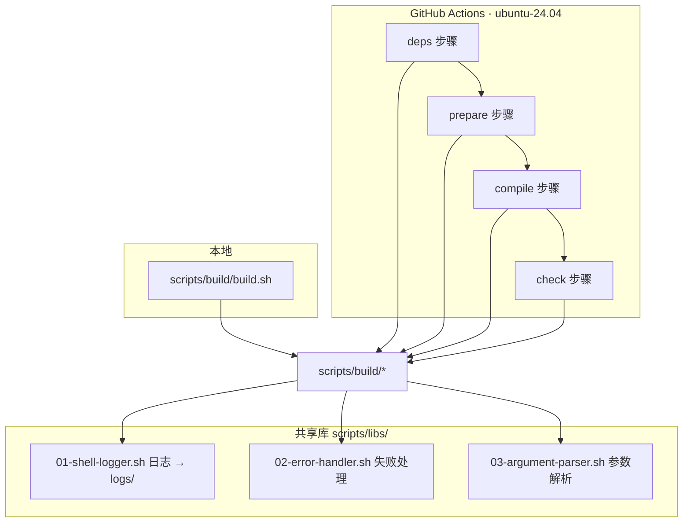

#  ImmortalWrt · BPI-R4 固件构建

> 🚀 为香蕉派 **BPI-R4** 路由器自动构建 ImmortalWrt 固件 —— 极简、可自动更新、软件包签名可信。

[](https://github.com/Shuery-Shuai/ImmortalWrt-BPI-R4-Firmware/actions/workflows/immortalwrt-builder.yml)
[](https://github.com/Shuery-Shuai/ImmortalWrt-BPI-R4-Firmware/actions/workflows/update-checker.yml)
[](https://github.com/Shuery-Shuai/ImmortalWrt-BPI-R4-Firmware/actions/workflows/dependency-auditor.yml)
[](LICENSE)
[](https://openwrt.org/docs/techref/targets)
[](https://github.com/immortalwrt/immortalwrt)
[](.github/workflows/immortalwrt-builder.yml)

## 📖 目录

- [✨ 项目特点](#-项目特点)
- [📦 固件内置组件](#-固件内置组件)
- [🧩 可选扩展包](#-可选扩展包)
- [🚀 快速开始](#-快速开始)
- [🔐 软件包签名密钥](#-软件包签名密钥)
- [🔄 固件更新与软件包恢复](#-固件更新与软件包恢复)
- [🛠️ 构建系统](#️-构建系统)
- [📄 许可证](#-许可证)
- [🙏 致谢](#-致谢)

## ✨ 项目特点

|     | 特性                          | 说明                                                                                 |
| :-- | :---------------------------- | :----------------------------------------------------------------------------------- |
| 🌱  | **基于 ImmortalWrt 最新源码** | 跟踪上游 `master`，由 Update Checker 每 3 天探测新提交并自动触发构建                 |
| ⚡  | **针对 BPI-R4 硬件优化**      | 目标 `mediatek/filogic`，设备 `bananapi_bpi-r4`，内核配置按该板网口/PWM/USB 能力裁剪 |
| 🎯  | **极简固件**                  | 仅内置基础组件 + Argon 主题 + Nginx；其余功能以可选包（`=m`）形式提供，按需安装      |
| 🔁  | **自动更新软件包**            | 升级固件时自动备份已装包列表，重启后由 hotplug 脚本恢复                              |
| 🔐  | **软件包签名可固定**          | 使用固定 EC P-256 密钥签名仓库，避免升级后出现 `UNTRUSTED signature`                 |
| 🧪  | **CI 与本地同一套脚本**       | 构建逻辑全部在 `scripts/` 下，CI 只是把 stage 拆成几步，本地可完整复现               |
| 📊  | **失败可诊断**                | 每步日志落 `logs/`，流水线末尾生成运行总结并摘录编译错误行                           |

> [!TIP]
>
> - 首次刷机后**立即修改默认密码**。
> - 建议定期备份配置（`/etc/config`）。
> - 如遇网络异常，可先尝试重置防火墙：`fw4 restart`。

## 📦 固件内置组件

| 分类 | 软件包                  | 说明           |
| :--- | :---------------------- | :------------- |
| 界面 | `luci-theme-argon`      | Argon 主题     |
|      | `luci-app-argon-config` | Argon 主题配置 |
| 网络 | `luci-nginx`            | Nginx 前端引擎 |
|      | `luci-app-nginx`        | Nginx 前端管理 |
| 语言 | `default-settings-chn`  | 中文默认设置包 |

## 🧩 可选扩展包

以下软件包**已编译但未内置**（`.config` 中为 `=m`），可在系统 → 软件包中按需安装：

| 分类     | 软件包                          | 说明                                                 |
| :------- | :------------------------------ | :--------------------------------------------------- |
| 系统管理 | `luci-app-diskman`              | 磁盘管理                                             |
|          | `luci-app-easyupdate`           | 系统简易更新                                         |
|          | `luci-app-rtfwupgrade`          | 路由器固件更新                                       |
| 风扇控制 | `bpi-r4-pwm-fan`                | BPI-R4 PWM 风扇调速守护（直接操作 `/sys/class/pwm`） |
|          | `fan2go`                        | 风扇控制守护                                         |
|          | `luci-app-fancontrol`           | 简易风扇控制                                         |
|          | `luci-app-fanxpert`             | 风扇控制                                             |
| 系统工具 | `zram-swap`                     | 内存压缩交换                                         |
| 网络应用 | `luci-app-dae`                  | 大鹅网络工具                                         |
|          | `luci-app-lucky`                | 大吉内网穿透工具                                     |
|          | `luci-app-openclash`            | OpenClash 代理工具                                   |
|          | `dockerd`                       | Docker 容器引擎                                      |
| 下载     | `luci-app-qbittorrent-original` | 原版 qBittorrent 下载器                              |
| 多媒体   | `ffmpeg`                        | 多媒体处理工具                                       |
| 字体     | `noto-fonts-cjk`                | 中日韩字体                                           |
|          | `noto-fonts-emoji`              | Emoji 字体                                           |

> [!NOTE]
>
> 风扇控制类包有多个实现（`bpi-r4-pwm-fan` / `fan2go` / `fancontrol` / `fanxpert`），**请只选其中一个安装**。
> 它们都操作同一路 PWM 或 hwmon 接口，同时启用会互相抢控制权。
>
> 需要其他软件包请在 [Issues](https://github.com/Shuery-Shuai/ImmortalWrt-BPI-R4-Firmware/issues) 中提出。

## 🚀 快速开始

### 直接下载固件

前往 [Releases](https://github.com/Shuery-Shuai/ImmortalWrt-BPI-R4-Firmware/releases) 下载最新构建产物：

```text
ImmortalWrt_firmware_kernel_packages_<device>_<date>.tar.gz   # 内核相关包
ImmortalWrt_firmware_packages_<device>_<date>.tar.gz          # 用户态包
<target>/                                                      # sysupgrade / factory 镜像
```

### 本地构建

```shell
# 完整流程：准备 + 下载 + 编译 + 体积报告
scripts/build/build.sh all

# 或分阶段执行（阶段是累进的：compile 隐含 download 与 prepare）
scripts/build/build.sh deps      # 安装主机依赖（唯一会调用 apt 的阶段）
scripts/build/build.sh prepare   # 克隆源码 / 私钥 / feeds / .config / DIY / defconfig
scripts/build/build.sh download  # prepare + make download
scripts/build/build.sh compile   # download + 编译
scripts/build/build.sh check     # 只统计产物体积，不改动工作区
```

> [!NOTE]
>
> - `deps` **不会**被任何阶段自动触发 —— 本地依赖通常已装好，自动跑 `apt` 既重复又慢。
> - `prepare` 是**幂等**的：它按输入指纹（上游 commit、`.config`、DIY 脚本、`files/`、`libs/` 等）判断，
>   输入没变就跳过。需要强制重跑时设 `FORCE_PREPARE=1`。
> - `REQUIRED=1` 启用严格模式：缺 APK 私钥、缺依赖清单、装依赖失败都直接失败（CI 使用该模式）。
>
> 完整的目录结构、stage 语义、目录划分判据见 **[scripts/README.md](scripts/README.md)**。

## 🔐 软件包签名密钥

固件内置的软件包仓库使用固定的 **EC P-256** 密钥签名，保证设备升级固件后仍信任新构建的仓库，
不再出现 `UNTRUSTED signature`。

> [!CAUTION]
>
> `private-key.pem` 是包签名的**信任根**，持有者可以签出被本固件信任的 `.apk`。
> **切勿提交到仓库、粘贴到 Issue 或随产物分发。**
> 如需轮换密钥，须同时更新 Actions Secret 与 `keys/public-key.pem`，并通知用户重新导入公钥。

| 位置                                 | 说明                                                                                       |
| :----------------------------------- | :----------------------------------------------------------------------------------------- |
| `keys/public-key.pem`                | 公钥，随仓库提交；构建时写入镜像 `/etc/apk/keys/public-key.pem`，并发布到 Pages 站点根目录 |
| Actions Secret `APK_PRIVATE_KEY_B64` | 私钥（base64），CI 构建时还原到构建目录并校验指纹                                          |
| `keys/private-key.pem`               | 私钥的本地副本，供本地构建使用，已被 `.gitignore` 忽略                                     |

> [!IMPORTANT]
>
> 在固定密钥启用**之前**刷入的固件，需手动导入公钥后才能从本仓库安装软件包：
>
> ```sh
> wget -O /etc/apk/keys/public-key.pem https://pkgs.lssa.fun/immortalwrt/snapshots/public-key.pem
> apk update
> ```
>
> 或者直接刷写一次新固件（镜像内已自带该公钥）。apk 会信任 `/etc/apk/keys/` 下的所有密钥，新旧公钥可共存。

## 🔄 固件更新与软件包恢复

固件在升级时会记录已安装的用户软件包，重启后自动恢复：


> [!WARNING]
>
> - 手动更新固件时，请在更新选项中**勾选「备份已安装软件包」**。
> - 更新完成后系统将自动恢复之前安装的软件包，**恢复过程中请勿断电或重启**。

<!-- qBittorrent 升级保存路径：与上方 WARNING 分开，避免两个 alert 被 markdownlint 视为同一引用块 -->

> [!IMPORTANT]
>
> 使用 `qbittorrent-original` 时，需将 `/etc/qbittorrent` 加入系统升级保存列表。
> 编辑 `/etc/sysupgrade.conf` 添加：
>
> ```conf
> /etc/qbittorrent/
> ```

## 🛠️ 构建系统

所有构建逻辑收敛在 `scripts/` 下，CI 与本机执行**完全相同的脚本**：



| 流水线                  | 触发                                    | 作用                                                |
| :---------------------- | :-------------------------------------- | :-------------------------------------------------- |
| **ImmortalWrt Builder** | 上游更新后 `repository_dispatch` / 手动 | 编译固件、上传 artifact 与 Release、发布 Pages 索引 |
| **Update Checker**      | 每 3 天定时 / 手动                      | 探测上游新提交，有变化则触发 Builder                |
| **Dependency Auditor**  | 每周定时 / PR 改动依赖清单              | 校验依赖包名在 noble 仍存在、检查手钉工具是否有新版 |
| **Syntax Linter**       | 每次 PR / push 到 main / 手动           | shellcheck、actionlint、markdownlint 三条并列检查   |

构建产物与日志会分别作为 artifact 上传；日志位于仓库根 `logs/`（已 gitignore）。

## 📄 许可证

- 本项目脚本采用 **MIT** 许可证，见 [LICENSE](LICENSE)。
- 本项目 Actions 更改自 [P3TERX](https://github.com/P3TERX/Actions-OpenWrt)，采用 MIT 许可证，见 [LICENSE-workflow](LICENSE-workflow)。

## 🙏 致谢

- 感谢 [ImmortalWrt](https://github.com/immortalwrt/immortalwrt) 项目团队的持续贡献。
- 感谢 [Banana Pi](https://www.banana-pi.org/) 社区对 BPI-R4 硬件的支持。
- 感谢 [P3TERX](https://github.com/P3TERX/Actions-OpenWrt) 与 [sundaqiang](https://github.com/sundaqiang) 提供的 Actions 工作流模板。
