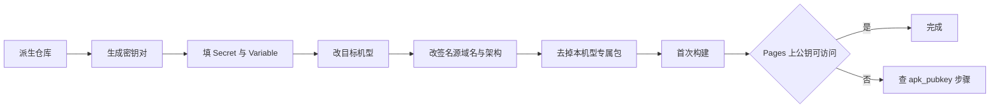
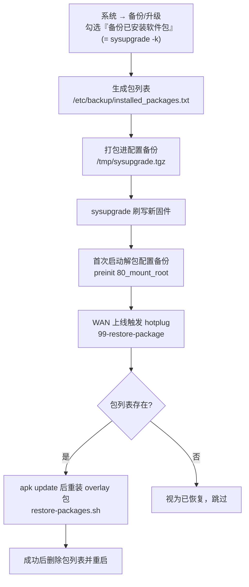
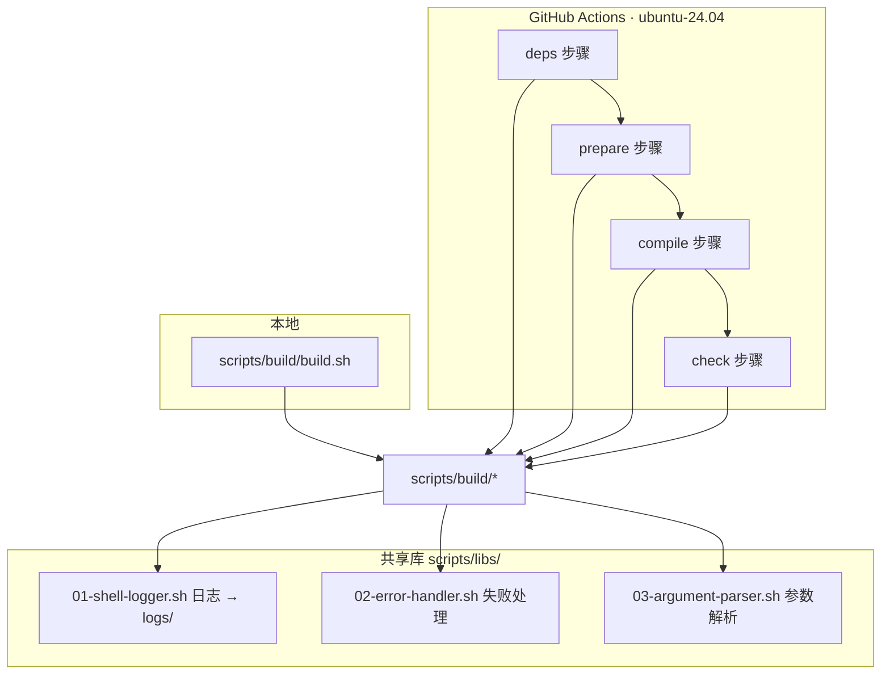

#  ImmortalWrt · BPI-R4 固件构建

> 🚀 为香蕉派 **BPI-R4** 路由器自动构建 ImmortalWrt 固件 —— 极简、可自动更新、软件包签名可信。

[](https://github.com/Shuery-Shuai/ImmortalWrt-BPI-R4-Firmware/actions/workflows/immortalwrt-builder.yml)
[](https://github.com/Shuery-Shuai/ImmortalWrt-BPI-R4-Firmware/actions/workflows/syntax-linter.yml)
[](LICENSE)
[](https://openwrt.org/docs/techref/targets)
[](https://github.com/immortalwrt/immortalwrt)
[](.github/workflows/immortalwrt-builder.yml)

## 📖 目录

- [✨ 项目特点](#-项目特点)
- [📦 固件内置组件](#-固件内置组件)
- [🧩 可选扩展包](#-可选扩展包)
- [🚀 快速开始](#-快速开始)
- [🔐 软件包签名密钥](#-软件包签名密钥)
- [🧳 移植教程：换机型与自建仓库](#-移植教程换机型与自建仓库)
- [🔄 固件更新与软件包恢复](#-固件更新与软件包恢复)
- [🛠️ 构建系统](#️-构建系统)
- [📄 许可证](#-许可证)
- [🙏 致谢](#-致谢)

## ✨ 项目特点

|     | 特性                          | 说明                                                                                 |
| :-- | :---------------------------- | :----------------------------------------------------------------------------------- |
| 🌱  | **基于 ImmortalWrt 最新源码** | 跟踪上游 `master`，由 Update Checker 每 3 天探测新提交并自动触发构建                 |
| ⚡  | **针对 BPI-R4 硬件优化**      | 目标 `mediatek/filogic`，设备 `bananapi_bpi-r4`，内核配置按该板网口/PWM/USB 能力裁剪 |
| 🎯  | **极简固件**                  | 仅内置基础组件 + Argon 主题 + Nginx；其余功能以可选包（`=m`）形式提供，按需安装      |
| 🔁  | **自动更新软件包**            | 升级固件时自动备份已装包列表，重启后由 hotplug 脚本恢复                              |
| 🔐  | **软件包签名可固定**          | 使用固定 EC P-256 密钥签名仓库，避免升级后出现 `UNTRUSTED signature`                 |
| 🧪  | **CI 与本地同一套脚本**       | 构建逻辑全部在 `scripts/` 下，CI 只是把 stage 拆成几步，本地可完整复现               |
| 📊  | **失败可诊断**                | 每步日志落 `logs/`，流水线末尾生成运行总结并摘录编译错误行                           |

> [!TIP]
>
> - 首次刷机后**立即修改默认密码**。
> - 建议定期备份配置（`/etc/config`）。
> - 如遇网络异常，可先尝试重置防火墙：`fw4 restart`。

## 📦 固件内置组件

| 分类 | 软件包                  | 说明           |
| :--- | :---------------------- | :------------- |
| 界面 | `luci-theme-argon`      | Argon 主题     |
|      | `luci-app-argon-config` | Argon 主题配置 |
| 网络 | `luci-nginx`            | Nginx 前端引擎 |
|      | `luci-app-nginx`        | Nginx 前端管理 |
| 语言 | `default-settings-chn`  | 中文默认设置包 |

## 🧩 可选扩展包

以下软件包**已编译但未内置**（`.config` 中为 `=m`），可在系统 → 软件包中按需安装：

| 分类     | 软件包                          | 说明                                                 |
| :------- | :------------------------------ | :--------------------------------------------------- |
| 系统管理 | `luci-app-diskman`              | 磁盘管理                                             |
|          | `luci-app-easyupdate`           | 系统简易更新                                         |
|          | `luci-app-rtfwupgrade`          | 路由器固件更新                                       |
| 风扇控制 | `bpi-r4-pwm-fan`                | BPI-R4 PWM 风扇调速守护（直接操作 `/sys/class/pwm`） |
|          | `fan2go`                        | 风扇控制守护                                         |
|          | `luci-app-fancontrol`           | 简易风扇控制                                         |
|          | `luci-app-fanxpert`             | 风扇控制                                             |
| 系统工具 | `zram-swap`                     | 内存压缩交换                                         |
| 网络应用 | `luci-app-dae`                  | 大鹅网络工具                                         |
|          | `luci-app-lucky`                | 大吉内网穿透工具                                     |
|          | `luci-app-openclash`            | OpenClash 代理工具                                   |
|          | `dockerd`                       | Docker 容器引擎                                      |
| 下载     | `luci-app-qbittorrent-original` | 原版 qBittorrent 下载器                              |
| 多媒体   | `ffmpeg`                        | 多媒体处理工具                                       |
| 字体     | `noto-fonts-cjk`                | 中日韩字体                                           |
|          | `noto-fonts-emoji`              | Emoji 字体                                           |

> [!NOTE]
>
> 风扇控制类包有多个实现（`bpi-r4-pwm-fan` / `fan2go` / `fancontrol` / `fanxpert`），**请只选其中一个安装**。
> 它们都操作同一路 PWM 或 hwmon 接口，同时启用会互相抢控制权。
>
> 需要其他软件包请在 [Issues](https://github.com/Shuery-Shuai/ImmortalWrt-BPI-R4-Firmware/issues) 中提出。

## 🚀 快速开始

### 直接下载固件

前往 [Releases](https://github.com/Shuery-Shuai/ImmortalWrt-BPI-R4-Firmware/releases) 下载最新构建产物：

```text
ImmortalWrt_firmware_kernel_packages_<device>_<date>.tar.gz   # 内核相关包
ImmortalWrt_firmware_packages_<device>_<date>.tar.gz          # 用户态包
<target>/                                                      # sysupgrade / factory 镜像
```

### 本地构建

```shell
# 完整流程：准备 + 下载 + 编译 + 体积报告
scripts/build/build.sh all

# 或分阶段执行（阶段是累进的：compile 隐含 download 与 prepare）
scripts/build/build.sh deps      # 安装主机依赖（唯一会调用 apt 的阶段）
scripts/build/build.sh prepare   # 克隆源码 / 私钥 / feeds / .config / DIY / defconfig
scripts/build/build.sh download  # prepare + make download
scripts/build/build.sh compile   # download + 编译
scripts/build/build.sh check     # 只统计产物体积，不改动工作区
```

> [!NOTE]
>
> - `deps` **不会**被任何阶段自动触发 —— 本地依赖通常已装好，自动跑 `apt` 既重复又慢。
> - `prepare` 是**幂等**的：它按输入指纹（上游 commit、`.config`、DIY 脚本、`files/`、`libs/` 等）判断，
>   输入没变就跳过。需要强制重跑时设 `FORCE_PREPARE=1`。
> - `REQUIRED=1` 启用严格模式：缺 APK 私钥、缺依赖清单、装依赖失败都直接失败（CI 使用该模式）。
>
> 完整的目录结构、stage 语义、目录划分判据见 **[scripts/README.md](scripts/README.md)**。

## 🔐 软件包签名密钥

固件内置的软件包仓库使用固定的 **EC P-256** 密钥签名，保证设备升级固件后仍信任新构建的仓库，
不再出现 `UNTRUSTED signature`。**密钥刻意不随构建轮换**，为的是两件事：

- **没刷本仓库固件的设备，也能稳定用本仓库的软件包**：官方固件或别的固件上的 apk 不认识这个签名，
  手动导入一次公钥（见下方 IMPORTANT）之后就能长期装包；密钥若每次构建重新生成，这次导入就白做。
- **不更新固件，也能更新软件包**：仓库索引始终由同一把私钥签名，设备上已有的公钥一直有效，
  只跑 `apk update` 装包、不刷机，同样不会出现 `UNTRUSTED signature`。

> [!CAUTION]
>
> `private-key.pem` 是包签名的**信任根**，持有者可以签出被本固件信任的 `.apk`。
> **切勿提交到仓库、粘贴到 Issue 或随产物分发。**
> 如需轮换密钥，须同时更新 Secret `APK_PRIVATE_KEY_B64` 与 Variable `APK_PUBLIC_KEY_SHA256`，
> 并通知用户重新导入新公钥；旧私钥对应的公钥仍在设备上被信任，删不回来。

公钥**不再随仓库分发**：`keys/public-key.pem` 已从版本库移除，改由编译期从私钥派生
（上游 `rules.mk` 的 `BUILD_KEY_APK_PUB`，由 `package/Makefile` 用 `openssl ec -pubout` 生成），
部署时随发布树一起发布到 Pages 并拷入镜像。因此仓库里**没有公钥文件可提交**，
fork 者克隆后必须自带一对密钥才能构建。

| 位置                                     | 说明                                                   |
| :--------------------------------------- | :----------------------------------------------------- |
| Actions Secret `APK_PRIVATE_KEY_B64`     | 私钥（base64），CI 构建时还原到构建目录                |
| Actions Variable `APK_PUBLIC_KEY_SHA256` | 公钥的 sha256 指纹，用来校验私钥没有漂移               |
| `keys/private-key.pem`                   | 私钥的本地副本，供本地构建使用，已被 `.gitignore` 忽略 |
| Pages `/keys/public-key.pem`             | 正式公钥地址，构建期派生后随发布树部署                 |
| Pages `/public-key.pem`                  | 同一份公钥的兼容副本，保留给旧的导入链接               |
| 镜像 `/etc/apk/keys/public-key.pem`      | 固件内自带的公钥，编译时从派生结果拷入                 |

> [!IMPORTANT]
>
> **刷本仓库固件的设备不需要手动导入公钥。** 公钥是 `base-files` 的普通包文件，**既不是 conffile、
> 也不在 `/lib/upgrade/keep.d` 里**；sysupgrade 默认走 `build_list_of_backup_config_files`
> （只收 keep 列表与 conffiles），所以这个文件根本不进配置备份——旧系统那份不会被恢复回来，
> 每次刷入新固件，`/etc/apk/keys/public-key.pem` 就是镜像自带的那一份，**公钥随固件自动更新**。
>
> 需要手动导入的只有**没刷本仓库固件**的设备（官方固件或别的固件），它们要用本仓库的软件包：
>
> ```sh
> wget -O /etc/apk/keys/public-key.pem https://immortalwrt.shuery.lssa.fun/keys/public-key.pem
> apk update
> ```
>
> 这类设备导入一次即可长期使用：密钥固定不轮换，仓库索引始终由同一把私钥签名，
> 所以**不刷固件也能持续 `apk update` 装包**。apk 会信任 `/etc/apk/keys/` 下的所有密钥，新旧公钥可共存。

### 移植（fork 本仓库）

本仓库**不含任何密钥文件**，fork 后必须生成自己的密钥对并写进仓库设置，否则构建会因为
缺少 `APK_PUBLIC_KEY_SHA256` 门禁基准而失败。整个过程只做一次（EC P-256，与上游
`BUILD_KEY_APK_SEC` / `BUILD_KEY_APK_PUB` 一致），命令与 `scripts/ci/check-apk-signing-key.sh`
缺变量时打印的指引逐字相同：

```sh
mkdir -p keys
openssl ecparam -name prime256v1 -genkey -noout -out keys/private-key.pem
openssl ec -in keys/private-key.pem -pubout -out keys/public-key.pem
base64 -w0 keys/private-key.pem                  # → Secret   APK_PRIVATE_KEY_B64
sha256sum keys/public-key.pem | awk '{print $1}' # → Variable APK_PUBLIC_KEY_SHA256
```

命令请在**仓库根**执行：`mkdir -p keys` 是相对仓库根的路径，两个生成物都落在 `keys/` 下
（`keys/private-key.pem` 正是本地构建缺省查找的位置）。这两行已被 `.gitignore` 的
`keys/private-key.pem` 与 `keys/public-key.pem` 忽略，但入库与否最终由你负责：
执行完用 `git status --short` 确认里面**看不到**这两个文件，再 `git add`。

拿到两串值后，在本仓库 **Settings → Secrets and variables → Actions** 里添加：

| 类型     | 名称                    | 值                                       |
| :------- | :---------------------- | :--------------------------------------- |
| Secret   | `APK_PRIVATE_KEY_B64`   | 第 2 步 `base64 -w0` 的整行输出          |
| Variable | `APK_PUBLIC_KEY_SHA256` | 第 2 步 `sha256sum` 输出的 64 位十六进制 |

> [!CAUTION]
>
> - `keys/private-key.pem` 与 `keys/public-key.pem` **都不要入库**：二者都在 `.gitignore` 里，
>   且公钥由构建期从私钥派生，提交进来反而多一份要同步的信任锚副本。
> - **私钥一旦泄漏**（误提交、误粘贴、发给他人），唯一正确的处置是**立刻轮换密钥对**：
>   按上面的命令重新生成，把新的 Secret/Variable 更新到仓库设置。
>   历史提交里的旧私钥删不掉，撤回也无意义——旧公钥仍被已刷机设备信任。
> - 轮换是**破坏性**的，要分两类用户处理：刷本仓库固件的设备**刷一次新固件即自动换新公钥**
>   （公钥随镜像下发，见 [软件包签名密钥](#-软件包签名密钥) 的 IMPORTANT）；没刷本仓库固件的
>   设备必须重新走一遍上面的 `wget` 导入，否则 `apk` 会因签名不匹配而拒绝装包。
> - 也正因轮换有代价，密钥应当**固定**：它同时服务「没刷本仓库固件的用户」与「不刷固件只更新
>   软件包的用户」，频繁更换会让这两类用户的导入反复失效。

门禁行为：**基准指纹有两块来源，取值链与私钥一致**——环境变量 `APK_PUBLIC_KEY_SHA256`（CI 的 Variable）
优先，缺失时回退到本地 `keys/public-key.pem` 的 sha256（与本地直接读 `keys/private-key.pem` 同一思路）。

| 场景                             | 基准来源     | 结果                                                |
| -------------------------------- | ------------ | --------------------------------------------------- |
| CI（Variable + Secret）          | Variable     | 正常校验私钥派生出的公钥                            |
| 本地（有 `keys/public-key.pem`） | 本地公钥文件 | 直接通过，无需配 Variable                           |
| 两者都有但指纹不同               | Variable     | 通过，但**警告本地密钥已漂移**                      |
| 两者都没有                       | —            | CI 硬失败；本地降级为告警，用一次性密钥也能编出固件 |

本地公钥因此不再是只写不读的死文件：它既用来算基准，也让本地与 CI 走同一条校验路径。

## 🧳 移植教程：换机型与自建仓库

本仓库是**为 BPI-R4 定制**的构建仓库，不是通用模板：目标设备、软件源域名与专属软件包都写死在仓库里。
移植分两类，可以只做其中一类：

- **换机型**：沿用本仓库的 Pages 与密钥，只把目标设备换成你自己的板子。
- **自建仓库**：把整套流程搬到自己的仓库，域名、密钥、机型一起换掉。



> [!IMPORTANT]
>
> 顺序不能颠倒：**先密钥、再机型**。CI 的 job 第一步就是密钥门禁，密钥没配好会在编译开始前
> 失败，这时改机型没有任何意义。

### 第 1 步：准备密钥与仓库设置

按上文 [移植（fork 本仓库）](#移植fork-本仓库) 生成 EC P-256 密钥对并写入设置项。除此之外 CI 还需要
一个 PAT —— `update-checker` 靠它派发 Builder：

| 类型     | 名称                    | 用途                                          |
| :------- | :---------------------- | :-------------------------------------------- |
| Secret   | `APK_PRIVATE_KEY_B64`   | 包签名私钥；缺了它镜像会改用一次性密钥        |
| Variable | `APK_PUBLIC_KEY_SHA256` | 公钥指纹；缺了它 CI 在门禁处直接失败          |
| Secret   | `ACTIONS_TRIGGER_PAT`   | 定时巡检发现上游新提交后，派发 Builder 需要它 |

> [!NOTE]
>
> Pages 的自定义域名**不在仓库里**（仓库内没有 `CNAME` 文件），它配置在仓库
> Settings → Pages 中。换域名时两处都要改：Pages 设置里改域名，`customfeeds.list` 里改 URL。

### 第 2 步：改目标机型（必改）

目标平台由仓库根的 `.config` 决定（`prepare` 阶段把它复制成 `immortalwrt/.config`）。真正要动的
只有下面 6 行，命名规律是 `CONFIG_TARGET_<board>_<subtarget>[_DEVICE_<device>]`：

```dotenv
# 以 qualcommax/ipq807x 为例：替换原来的 mediatek/filogic + bananapi_bpi-r4
CONFIG_TARGET_qualcommax=y
CONFIG_TARGET_qualcommax_ipq807x=y
CONFIG_TARGET_qualcommax_ipq807x_DEVICE_your_device_id=y
CONFIG_TARGET_BOARD="qualcommax"
CONFIG_TARGET_SUBTARGET="ipq807x"
CONFIG_TARGET_PROFILE="DEVICE_your_device_id"
```

设备 ID 不要猜，直接从上游的设备定义里查（`prepare` 跑完 `immortalwrt/` 才存在）：

```shell
grep '^define Device/' immortalwrt/target/linux/<board>/image/<subtarget>.mk
```

也可以 `cd immortalwrt && make menuconfig` 点选目标后，把生成的 `.config` 里这几行抄回仓库根。
第 8 行 `CONFIG_TARGET_ROOTFS_PARTSIZE=796` 是 BPI-R4 的分区大小，新机型按自己的存储改，
或整行删掉用上游默认值。

### 第 3 步：改签名源（换域名或换架构必改）

`files/etc/apk/repositories.d/customfeeds.list` 把本仓库的 Pages 地址硬编码进 7 行（含 3 行注释），
要换两处：域名，以及 `targets/<board>/<subtarget>` 与 `packages/<arch>` 两段路径。

```shell
sed -i 's|immortalwrt\.shuery\.lssa\.fun|<你的 Pages 域名>|g' \
    files/etc/apk/repositories.d/customfeeds.list
sed -i 's|aarch64_cortex-a53|<你的目标架构>|g' \
    files/etc/apk/repositories.d/customfeeds.list
```

> [!TIP]
>
> 架构值**不在**仓库根的 `.config` 里：它由 `make defconfig` 按目标推导。先跑一次
> `scripts/build/build.sh prepare`，再 `grep '^CONFIG_TARGET_ARCH_PACKAGES' immortalwrt/.config` 读回来。

### 第 4 步：去掉本机型专属的东西

下列内容只对 BPI-R4 有意义，换机型时应当移除，否则会多打包一个用不上的守护进程，
或对错误的 DTS 做分区手术：

| 位置                                          | 内容                                                  | 处理                                   |
| :-------------------------------------------- | :---------------------------------------------------- | :------------------------------------- |
| `scripts/inputs/diy-part1.sh`（第 33–36 行）  | `clone_repo` 引入 `bpi-r4-pwm-fan`（PWM 风扇守护）    | 删掉或注释这条 `clone_repo`            |
| `.config`（第 82 行）                         | `CONFIG_PACKAGE_bpi-r4-pwm-fan=m`                     | 删掉，或换成你机型对应的风扇包         |
| `scripts/inputs/mods/12-modify-partition.sh`  | 只认 `mediatek/image/filogic.mk` 与 `bananapi_bpi-r4` | 保持不启用（调用处已注释，见第 26 行） |
| `scripts/ci/generate-summary.sh`（第 160 行） | 运行总结标题写死「ImmortalWrt BPI-R4 构建总结」       | 改成你的机型；纯展示，不影响构建       |

> [!TIP]
>
> `scripts/inputs/mods/` 下的其它 mod（默认 IP、默认 Shell、LuCI 集合补丁、Rust 配置、
> libnl-tiny 修复等）与机型无关，可以原样保留。

### 第 5 步：换源码分支（可选）

默认跟踪 ImmortalWrt 的 `master`。换上游（例如改回 OpenWrt 官方，或钉在某条分支）时两个
workflow 都要改 —— `update-checker` 用同一对变量判断上游有没有新提交：

```yaml
# .github/workflows/immortalwrt-builder.yml（第 29–30 行）
# .github/workflows/update-checker.yml（第 15–16 行）
REPO_URL: https://github.com/immortalwrt/immortalwrt
REPO_BRANCH: master
```

脚本侧有同名默认值兜底（`scripts/build/pipeline.sh`），因此只改 workflow 也能生效。

### 第 6 步：首次构建与验证

推送后手动跑一次 **ImmortalWrt Builder**（Actions → Run workflow），再按下表核对：

| 检查项           | 做法                                              | 期望结果                 |
| :--------------- | :------------------------------------------------ | :----------------------- |
| 目标机型生效     | `grep '^CONFIG_TARGET' immortalwrt/.config`       | 六行都指向你的目标       |
| 密钥门禁通过     | 看 job 第 5 步 `Verify apk signing key`           | 绿；红则回到第 1 步      |
| 公钥已进产物     | 看 `Publish apk public key into bin`              | 绿；红说明没派生出公钥   |
| Pages 公钥可访问 | `curl -sI https://<你的域名>/keys/public-key.pem` | `200`                    |
| 设备能从仓库装包 | 刷入新固件后直接跑 `apk update`                   | 无 `UNTRUSTED signature` |

> [!CAUTION]
>
> 移植后首次刷入的固件就是「自带你的公钥」的那一版：公钥作为 `base-files` 包文件随镜像下发，
> 刷完即生效，**不需要手动导入**；之后更换密钥也只是再刷一次新固件。
> 真正的风险在**别人**身上：沿用旧仓库（或从旧仓库迁移）的设备上留着旧公钥，你的新私钥签出的包
> 会被它们拒绝。这不受本教程控制，只能通过通知用户重新导入公钥来兜底，见
> [软件包签名密钥](#-软件包签名密钥) 的 IMPORTANT 块。

### 不用改的部分

以下内容与机型无关，移植时不要动，动了只会引入风险：

- `scripts/libs/`、`scripts/build/steps/`、`scripts/ci/check-apk-signing-key.sh`：通用能力。
- CI 的分步结构与 `STEP_SEQUENCE`：artifacts、Release、Pages 都靠它对齐。
- 产物命名：`DEVICE_NAME` 由 `grep '^CONFIG_TARGET.*DEVICE.*=y' immortalwrt/.config` 自动推导
  （见 `.github/workflows/immortalwrt-builder.yml` 第 216 行），改完 `.config` 它会自己跟上。

## 🔄 固件更新与软件包恢复

固件在升级时会记录已安装的用户软件包，重启后自动恢复：



> [!WARNING]
>
> - 手动更新固件时，请在更新选项中**勾选「备份已安装软件包」**。
> - 更新完成后系统将自动恢复之前安装的软件包，**恢复过程中请勿断电或重启**。

<!-- qBittorrent 升级保存路径：与上方 WARNING 分开，避免两个 alert 被 markdownlint 视为同一引用块 -->

> [!IMPORTANT]
>
> 使用 `qbittorrent-original` 时，需将 `/etc/qbittorrent` 加入系统升级保存列表。
> 编辑 `/etc/sysupgrade.conf` 添加：
>
> ```conf
> /etc/qbittorrent/
> ```

## 🛠️ 构建系统

所有构建逻辑收敛在 `scripts/` 下，CI 与本机执行**完全相同的脚本**：



| 流水线                  | 触发                                    | 作用                                                         |
| :---------------------- | :-------------------------------------- | :----------------------------------------------------------- |
| **ImmortalWrt Builder** | 上游更新后 `repository_dispatch` / 手动 | 编译固件、上传 artifact 与 Release、发布 Pages 索引          |
| **Update Checker**      | 每 3 天定时 / 手动                      | 探测上游新提交，有变化则触发 Builder                         |
| **Dependency Auditor**  | 每周定时 / PR 改动依赖清单              | 校验依赖包名在 noble 仍存在、检查手钉工具是否有新版          |
| **Syntax Linter**       | 每次 PR / push 到 main / 手动           | shellcheck、actionlint、markdownlint 三条并列检查            |
| **Dependabot Updates**  | 每周一定时                              | 扫描 action 版本漂移，按 minor/patch 分组开 PR、major 单独开 |
| **Dependabot Merger**   | Dependabot 开 PR 时                     | minor/patch 武装 auto-merge；major 与 0.x minor 留人工       |

构建产物与日志会分别作为 artifact 上传；日志位于仓库根 `logs/`（已 gitignore），文件名即步骤名
（`build-compile.log`、`build-deps.log`…），整包上传，选哪份由文件名决定而不是靠 mtime。

## 📄 许可证

- 本项目脚本采用 **MIT** 许可证，见 [LICENSE](LICENSE)。
- 本项目 Actions 更改自 [P3TERX](https://github.com/P3TERX/Actions-OpenWrt)，采用 MIT 许可证，见 [LICENSE-workflow](LICENSE-workflow)。

## 🙏 致谢

- 感谢 [ImmortalWrt](https://github.com/immortalwrt/immortalwrt) 项目团队的持续贡献。
- 感谢 [Banana Pi](https://www.banana-pi.org/) 社区对 BPI-R4 硬件的支持。
- 感谢 [P3TERX](https://github.com/P3TERX/Actions-OpenWrt) 与 [sundaqiang](https://github.com/sundaqiang) 提供的 Actions 工作流模板。
