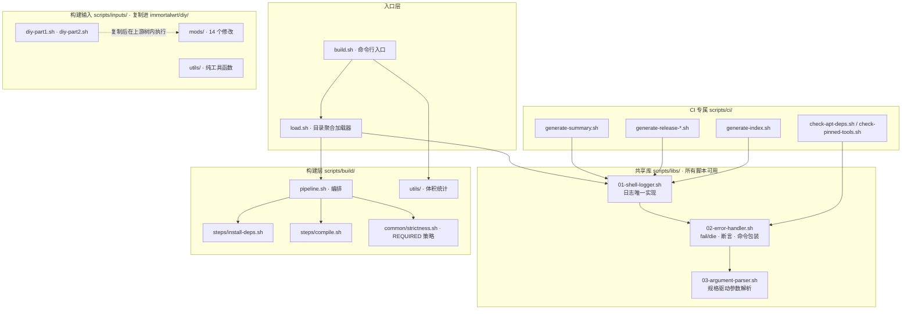
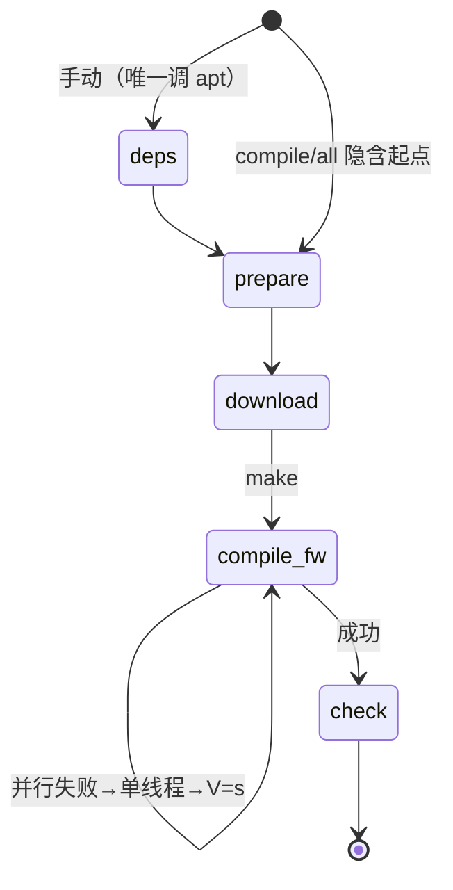

# scripts/ · 构建脚本说明

> 🛠️ 本地与 CI **共用同一套构建脚本**。固件功能、刷机、签名密钥等面向使用者的说明见 [仓库根 README](../README.md)。

[](https://github.com/Shuery-Shuai/ImmortalWrt-BPI-R4-Firmware/actions/workflows/immortalwrt-builder.yml)
[](https://www.gnu.org/software/bash/)
[](https://www.shellcheck.net/)
[](https://github.com/Shuery-Shuai/ImmortalWrt-BPI-R4-Firmware/blob/main/scripts/build/dependencies.txt)

## 📖 目录

- [🗺 架构总览](#-架构总览)
- [🚀 本地构建](#-本地构建)
- [🌲 目录结构](#-目录结构)
- [📊 CI 运行总结](#ci-运行总结cigenerate-summarysh)
- [📦 依赖自动更新与巡检](#依赖自动更新与巡检)
- [🛡️ 错误处理](#错误处理libs02-error-handlersh)

## 🗺 架构总览

脚本分成三层，**按消费方划分**而非按文件类型：



> [!NOTE]
>
> 加载顺序即依赖顺序，编号 `01 → 02 → 03` 不可调换：`02-error-handler` 调用 `log_error`，
> 因此必须晚于 `01-shell-logger`；`03-argument-parser` 报错时同样依赖 logger。

## 🚀 本地构建

CI 与本地走同一套脚本，唯一入口是 `scripts/build/build.sh`。CI 只是把下面几个 stage 拆成几个步骤。

```shell
scripts/build/build.sh <stage> [--no-ccache]
```

| 选项          | 作用                                                                                                           |
| ------------- | -------------------------------------------------------------------------------------------------------------- |
| `--no-ccache` | 关闭编译缓存 ccache（**默认启用**）。ccache 由 `prepare` 阶段写入 `CONFIG_CCACHE=y` 并 `make oldconfig` 规范化 |

| stage      | 做什么                                                                                            |
| ---------- | ------------------------------------------------------------------------------------------------- |
| `deps`     | 按 `scripts/build/dependencies.txt` 安装主机依赖（目标 ubuntu-24.04），再补装 upx/padjffs2/po2lmo |
| `prepare`  | 克隆 immortalwrt → 还原 APK 私钥 → feeds → 放置 `.config` → DIY → `make defconfig` → 启用 ccache  |
| `download` | `prepare` + `make download`                                                                       |
| `compile`  | `download` + 编译（并行 → 单线程 → 单线程 V=s，失败后按需清理重试）                               |
| `check`    | 只统计 `bin/targets` 产物体积，**不改动工作区**                                                   |
| `all`      | `compile` + `check`                                                                               |



阶段是累进的：`compile` 隐含 `download` 与 `prepare`，所以一条 `scripts/build/build.sh compile` 就能从零到编译完成。

> [!NOTE]
>
> - `deps` 不会被任何阶段自动触发（本地通常已装好依赖，自动跑 apt 既重复又慢）。
> - `prepare` 是**幂等**的：它按输入指纹（上游 commit、`.config`、DIY 脚本、`files/`、`feeds.conf`、`libs/`、`mods/`）判断，
>   输入没变就跳过。因此 CI 里「`prepare` 步骤 + `compile` 内含的 prepare」不会重复工作，也不会删掉期间生成的 `99-release-info`。
>   需要强制重跑时设 `FORCE_PREPARE=1`。
> - `REQUIRED=1` 启用严格模式：缺 APK 私钥、缺签名公钥指纹（`APK_PUBLIC_KEY_SHA256`）、
>   缺依赖清单、装依赖失败都直接失败。CI 使用该模式，本地缺省为降级告警。
> - 早期 4 个薄转发入口（旧 `make.sh` / `prepare-workdir.sh` / `set-config.sh` / `initialize-environment.sh`）已删除，
>   一律用 `scripts/build/build.sh <stage>` 代替：compile / prepare / prepare / deps 一一对应。
> - **日志**：默认落仓库根 `logs/`。**库不管命名，仓库管命名**——`libs/01-shell-logger.sh` 是通用库
>   （还会被复制进 `immortalwrt/` 供 `diy-part*.sh`、`mods/`、`utils/` 使用），它只提供格式与默认路径
>   （缺省文件名 = 主脚本名，如 `build.log`、`deps.log`），不认识 `build-` 前缀，也不该认识。
>   本仓库的约定由调用方落实：入口脚本在 source 之前设 `LOG_FILE_BASENAME`。
>
>   | 调用方                                | 文件名                                                        |
>   | ------------------------------------- | ------------------------------------------------------------- |
>   | `build.sh <stage>`                    | `build-<stage>.log`（`build-compile.log`、`build-deps.log`…） |
>   | `ci/generate-release-info.sh`         | `build-generate-release-info.log`                             |
>   | `ci/generate-summary.sh` 等纯产物脚本 | 不写文件日志（`LOG_TO_FILE=false`）                           |
>
>   编译阶段的 make 原始输出另存 `build-compile-parallel/single/verbose.log`。
>   文件名**不带时间戳也不带 PID**：带 `$$` 会让每个 bash 子进程各算一份，一次运行散成十几个
>   `build-<秒>-<PID>.log`，事后谁也分不清哪份是哪步；而按 mtime 挑"最新"又只能挑到"最后写的"，
>   不是"这次构建的"——摘要因此引用过一份自己刚写下的空日志。改为固定名后，同一次运行的父子 shell
>   全部追加进同一份，失败后缀变体（`-parallel` 等）留档不覆盖。
>   行内标记仍是**调用方源文件名**（`[07-git-utils]`、`[diy-part2]`），因为一份日志里往往有多个模块在写。

## 🌲 目录结构

```text
scripts/
├── build/                   构建逻辑：本地与 CI 共用
│   ├── build.sh             【入口】命令行入口：usage + 6 个 stage 分派
│   ├── load.sh              【入口】目录聚合加载器：按固定顺序 source 各模块，不含业务逻辑
│   ├── pipeline.sh          【编排】prepare 编排：克隆、私钥、feeds、自定义文件、.config、幂等指纹
│   ├── steps/               【阶段】单个 stage 的实现（有副作用）
│   │   ├── install-deps.sh  依赖安装 / upx、padjffs2、po2lmo 补装（deps 阶段）
│   │   └── compile.sh       下载、编译、失败兜底清理（download / compile 阶段）
│   ├── common/strictness.sh 【策略】REQUIRED 严格度（项目专属，换项目不适用）
│   ├── utils/01-check-size-utils.sh 【工具】固件体积统计函数（无状态，仅被 build.sh check 调用）
│   └── dependencies.txt     主机依赖唯一事实源
├── libs/                    共享函数库：所有脚本都可调用，编号即加载序
│   ├── 01-shell-logger.sh   日志唯一实现（log + log_info/log_success/log_warning/log_error）
│   ├── 02-error-handler.sh  失败处理：退出码常量、fail/die、require_* 断言、run/try 命令包装
│   ├── 03-argument-parser.sh 参数解析：parse_args / validate_required_args / validate_enum
│   └── load.sh              目录聚合加载器：按 01→02→03 依赖顺序加载后再加载 utils/
├── ci/                      仅 CI 用的产物生成脚本，本地日常构建无需关心
│   ├── generate-release-info.sh   生成 99-release-info 与 RELEASE_TAG
│   ├── generate-release-notes.sh  生成 release.txt
│   ├── generate-summary.sh        运行总结 → $GITHUB_STEP_SUMMARY
│   ├── check-apt-deps.sh          依赖清单的包名是否仍存在于 noble 索引
│   ├── check-pinned-tools.sh      手钉常量（upx / padjffs2 / po2lmo / dae / fan2go）与上游的差距
│   └── generate-index.sh    生成 Pages 索引页
└── inputs/                  构建输入：被复制进 immortalwrt/diy/ 后在上游源码树内执行
    ├── diy-part1.sh
    ├── diy-part2.sh
    ├── utils/               工具函数库：仅 DIY 脚本调用（无状态纯函数）
    └── mods/                针对上游源码的具体修改
```

> [!NOTE]
>
> 复制**目标**是 `immortalwrt/diy/`（不是 `immortalwrt/` 根）：脚本本体与它的依赖
> `libs/`、`mods/`、`utils/` 一起落进去，上游树根只多出一个 `diy/` 目录，
> 一眼能看出"这些是本仓库注入的"。
>
> 两条契约改动时不可破坏：
>
> 1. **同层**：`diy-part*.sh` 与 `libs/`、`mods/`、`utils/` 必须都在 `diy/` 下——
>    脚本以 `SCRIPT_DIR` 定位 `${SCRIPT_DIR}/libs/load.sh`，拆开放就 source 不到。
> 2. **路径基准仍是 `immortalwrt/` 根**：`custom-packages/`、`files/`、`feeds/` 都在根下，
>    因此两个 DIY 脚本会先 `cd` 到上一级再干活（见各自文末的 `_diy_repo_base`）。
>    执行入口由 `run_diypart1/2` 定为 `immortalwrt/diy/diy-part*.sh`，cwd 仍是根。

<!-- 与上方 NOTE 分开，避免两个相邻 alert 被当成同一引用块 -->

> [!NOTE]
>
> 目录按**消费方**划分而非按文件类型：`build/` 是本地与 CI 共用的构建逻辑，`ci/` 只放「CI 专属且本地无意义」的产物生成脚本，
> `inputs/` 是会被复制进 `immortalwrt/` 在上游源码树内执行的构建输入（位置与文件名保持不变）。
>
> `build/` 内部按**职责**分四类，改文件时先认清它属于哪一类：
>
> | 类别 | 文件                         | 判据                                          |
> | ---- | ---------------------------- | --------------------------------------------- |
> | 入口 | `build.sh`、`load.sh`        | 只做分派 / source，不含业务逻辑               |
> | 编排 | `pipeline.sh`                | 串起多个步骤、决定顺序与幂等                  |
> | 阶段 | `steps/*.sh`                 | 实现单个 stage（deps / download / compile）   |
> | 策略 | `build/common/strictness.sh` | REQUIRED 严格度（项目专属语义，换项目不适用） |
>
> `build.sh` 与 `load.sh` **职责不同，不可合并**：`build.sh` 是**命令行入口**（解析 stage、打印 usage、`cd` 到仓库根）；
> `load.sh` 是**目录聚合加载器**（被 `build.sh` 与 `scripts/ci/*.sh` 共同 source，按顺序加载全部函数）。
> 只保留一个会让「拿库函数的 CI 脚本」被迫继承 stage 分派逻辑。
>
> `build/steps/`、`build/common/`、`scripts/libs/` 与 `inputs/utils/` **刻意不合并**，因为性质不同：前者是**编排**——`prepare_all`、
> `copy_custom_files`、`compile_firmware`、`install_dependencies` 这类有副作用、驱动整条流水线的函数；
> 后者是**纯工具**——`download_and_hash`、`clone_repo`、`set_makefile_vars`、
> `normalize_pkg_version` 这类无状态函数。
>
> `build/build.sh` 保持原名：它是多 stage 的分派器（deps / prepare / download / compile / check / all），
> 名字表达的是「构建唯一入口」，改成动宾反而失真。

<!-- 复制后的布局约束：与上方目录结构 NOTE 分开，避免两个 alert 被视为同一引用块 -->

> [!IMPORTANT]
>
> 复制到 `immortalwrt/` 后，`libs/`、`utils/`、`mods/` 与 `diy-part*.sh` 必须**保持同层**：DIY 脚本用 `${SCRIPT_DIR}/libs/load.sh` 定位依赖。
> 它们会被复制到 `immortalwrt/` 根的同一层，因此迁移目录时只能改仓库侧位置，不能改变复制后的相对布局。

### CI 运行总结（`ci/generate-summary.sh`）

一次运行的结论散落在各步骤日志里，想知道为什么红要逐个点开。`generate-summary.sh` 把它压成一段 Markdown 写进`$GITHUB_STEP_SUMMARY`，运行页顶部直接能看到步骤状态、产物和关键错误行。

```sh
bash scripts/ci/generate-summary.sh [build|update-checker|dependency-auditor|syntax-linter]   # 缺省 build
```

| 项     | 约定                                                                                                  |
| ------ | ----------------------------------------------------------------------------------------------------- |
| 输出   | 设了 `GITHUB_STEP_SUMMARY` 就追加写入该文件；否则打印到 stdout **并落一份 `logs/summary.md`**         |
| 退出码 | 恒为 `0`——摘要自身绝不能让流水线变红                                                                  |
| 参数   | `build` / `update-checker` / `dependency-auditor` / `syntax-linter`，决定标题与适用章节；缺省 `build` |

**入参全是环境变量，缺哪个就跳过对应小节**，所以本地不设任何变量也能跑出可用的一段 Markdown。

| 变量                                                                  | 用途                                                                                                                                                                    |
| --------------------------------------------------------------------- | ----------------------------------------------------------------------------------------------------------------------------------------------------------------------- |
| `JOB_STATUS`                                                          | job 总状态（`${{ job.status }}`），表头成败的依据                                                                                                                       |
| `STEP_SEQUENCE`                                                       | 多行，按显示顺序每行 `KEY\|显示名称`，决定步骤状态表的行序与显示名                                                                                                      |
| `STEP_<KEY>`                                                          | 该步骤的 outcome（`success` / `failure` / `cancelled` / `skipped` / 空）                                                                                                |
| `DEVICE_NAME` / `FILE_DATE` / `RELEASE_TAG`                           | 元信息：机型、文件日期、发布 tag                                                                                                                                        |
| `ARTIFACT_BIN_NAME` / `ARTIFACT_FIRMWARE_NAME` / `ARTIFACT_LOGS_NAME` | 产物名                                                                                                                                                                  |
| `CACHE_HIT`                                                           | 构建缓存是否命中（`true` / `false`，摘要渲染成「命中 / 未命中」）                                                                                                       |
| `LOG_DIR`                                                             | 日志目录，相对仓库根，缺省 `logs`（选源只认 `LOG_NAME_CATALOG` 里的文件名）                                                                                             |
| `TARGET_PACKAGE_INDEX_FILE`                                           | target 专属包 `index.json` 的快照路径；CI 里该目录会被摘要步骤之前删掉，靠这份副本补回（缺省空，回退到 glob）                                                           |
| `COMMIT_HASH` / `BUILD_TRIGGERED`                                     | `update-checker` 专用：检出的上游 commit、是否触发了构建                                                                                                                |
| `METRIC_SEQUENCE` / `METRIC_<KEY>`                                    | `dependency-auditor` / `syntax-linter` 专用：「本次结果」表，与 `STEP_SEQUENCE` 同写法，只差前缀                                                                        |
| `DETAIL_SEQUENCE` / `DETAIL_<KEY>`                                    | 同上两条流水线专用：「明细」折叠块，`DETAIL_<KEY>` 为空则整块跳过                                                                                                       |
| 标准 `GITHUB_*`                                                       | `GITHUB_REPOSITORY` / `_SERVER_URL` / `_RUN_ID` / `_RUN_ATTEMPT` / `_WORKFLOW` / `_REF_NAME` / `_EVENT_NAME` / `_ACTOR` / `_JOB`、`RUNNER_OS`：链接、run 号、触发方式等 |

摘要按下面几块拼装，每一块都只在自己的输入存在时才出现：

| 小节                                               | 内容                                                             | 依据                                                                                             |
| -------------------------------------------------- | ---------------------------------------------------------------- | ------------------------------------------------------------------------------------------------ |
| 结论 + 运行链接                                    | 成功 / 失败、`server/repo/actions/runs/<id>`                     | `JOB_STATUS`、`GITHUB_REPOSITORY`、`GITHUB_RUN_ID`                                               |
| 运行信息                                           | workflow、job、事件、分支、提交、触发人、Runner OS、run attempt  | 标准 `GITHUB_*` + `git rev-parse`                                                                |
| 上游更新                                           | 检出的上游 commit、是否触发构建（仅 `update-checker`）           | `COMMIT_HASH`、`BUILD_TRIGGERED`                                                                 |
| 步骤状态                                           | 按 `STEP_SEQUENCE` 逐行列出 outcome，带结果徽标                  | `STEP_SEQUENCE` + `STEP_<KEY>`                                                                   |
| 构建产物（仅 `build`）                             | 设备、文件日期、发布标签、构建缓存、产物名、固件体积             | `DEVICE_NAME` / `FILE_DATE` / `RELEASE_TAG` / `CACHE_HIT` / `ARTIFACT_*_NAME`                    |
| 软件包（仅 `build`）                               | 「装进固件」「编译产出」（bin/staging 分行）+ 编译验证，清单折叠 | `bin/targets/*/*/*.manifest`、`bin/**/index.json`、`staging_dir/packages`、`immortalwrt/.config` |
| 日志文件                                           | `LOG_DIR` 里实际产出的日志 → 它属于哪个 workflow 步骤            | `LOG_DIR` 目录内容 + `LOG_NAME_CATALOG`                                                          |
| 耗时与缓存                                         | 按候选清单选中一份带首尾时间戳的日志算时长；有 ccache 时附命中率 | `LOG_DIR` + `LOG_NAME_CATALOG`                                                                   |
| 失败详情                                           | 从选中的日志末尾筛出关键错误行，折叠在 `<details>` 里            | job 失败时的 `LOG_DIR`                                                                           |
| 本次结果（`dependency-auditor` / `syntax-linter`） | 按 `METRIC_SEQUENCE` 逐行列出指标，带显示名                      | `METRIC_SEQUENCE` + `METRIC_<KEY>`                                                               |
| 明细（`dependency-auditor` / `syntax-linter`）     | 按 `DETAIL_SEQUENCE` 把长正文折叠进 `<details>`                  | `DETAIL_SEQUENCE` + `DETAIL_<KEY>`                                                               |

选源不靠 mtime：日志文件名是**规则命名**（`build-<stage>.log` 这类固定名），选哪一份由`LOG_NAME_CATALOG` 这份可 review 的清单决定，mtime 只用来排目录列表的顺序。原因见
[本地构建](#-本地构建)的日志说明：mtime 只能答「谁最后写」，答不出「哪份属于这次构建」——按 mtime 挑，恰好会挑到摘要步骤自己刚写的那份空日志。

失败摘录是「诊断辅助」而非「原因判定」：它扫描的是选中日志的末尾若干行并按关键字过滤，真正的原因仍以该日志为准，摘要只负责把人带到那一行。

「软件包」小节刻意把几个数字分开，因为语义不同、混成一个清单会误导人：

- **装进固件**（`bin/targets/*/*/*.manifest`）：镜像内自带，开机即有。`.config` 里 `=y` 的包在这里。
- **编译产出**：按落盘目录**分行展示**，不合并成一个数字，因为语义不同：
  - `bin/packages/<arch>/<feed>/`（`index.json`）：target 无关的 feed 包，最终发布产物。
  - `bin/targets/<board>/<sub>/packages/`（`index.json`）：target 专属包（kmod-\*），同为发布产物。
    **CI 里这个目录在统计前已被删掉**：`Organize files` 为缩小 firmware artifact 执行 `rm -rf packages`， 而 `Run summary` 排在它之后。删除前该步骤把索引拷到
    `$RUNNER_TEMP` 并通过 `TARGET_PACKAGE_INDEX_FILE` 传进来，两份来源择一使用。少了这份快照，154 个包会全部落进 「未产出」——实测 `245 / 398`（153 条假报），补上后
    `398 / 398`。
  - `staging_dir/packages/<board>/`：**全是指向 `bin/` 的符号链接**，不是独立产物。
    实测 381 个链接 = 227（`bin/packages`）+ 154（`bin/targets`），与 bin 并集完全对应； 统计必须用 `-type l`，用 `-type f` 会得到 0。
    「编译验证」的口径是**两处 `index.json` 的并集**（实测 227+154=381）：只收前者会把上百个 kmod 误判成未编译。
- **引导固件**：同样按目录分行——`bin/targets/` 里是已进发布目录的成品（`<device>-bl31-uboot.fip`），
  `staging_dir/.../image/` 里是暂存中间件（`<变体>-bl2.img` / `<变体>-bl31.bin`）。 两处**内容不同**（实测各 17 个、交集为 0），所以不合并，否则读者会以为同一批被数了两遍。
- **编译验证**：`.config` 里 `=y|=m` 的项减去实际产出，报出「计划 / 实际」。全部成功时显示 `✅`，
  否则 `⚠️` 并折叠列出未产出项。**只统计不判失败**——未编进固件可能是配置有意精简， 真故障由 `make` 自己红，不该让摘要越权定性。
- **未生效的变体开关**：形如 `<基包>_<开关>` 但宿主包本身未被选中的项（如 `knot-resolver_dnstap=y`
  却没有 `knot-resolver`）。与「未产出」分开报，因为它是配置现象而非编译失败： 宿主没参与构建，开关为 `y` 也不会产生任何效果。这类项的宿主包会从「未产出」里剔掉， 避免同一件事报两遍。

**成因已实测确认，不是「配置残留」**：`knot-resolver` 的 `Config.in` 写的是 `default y` 且无 `depends` 约束，因此从干净的根 `.config` 跑 `make defconfig`
就会**自动生成**这一行； 手工置为 `n` 后 `defconfig` 也保持 `n`（说明它并非被反复拉回 `y`）。 结论：`defconfig` 清不掉它，无需建议用户清理——要彻底消除只能改 `Config.in` 的默认值。

验证口径有四个坑，都已按实测处理：

1. `.config` 里 `CONFIG_PACKAGE_*` 混着**非独立包**的选择项：变体开关（`*_INCLUDE_*`、`dnsmasq_full_dhcp`）
   与纯大写子选项（`TAR_GZIP`、`MAC80211_MESH`）。它们不产出独立包，必须先归一化或排除， 否则「未编译」永远不为 0。
2. 引导固件（`u-boot-*` / `trusted-firmware-a-*`）产物是 `.bin`/`.fip`/`.img` 而非 `.apk`，判据改成比文件名词干。
   两类命名习惯还不一样：`trusted-firmware-a-mt7988-ram-comb` 保留 SoC， 而 `u-boot-mt7988_bananapi_bpi-r4-emmc` 的产物**只有板名**（不含 SoC）。
3. 引导固件产物**只扫 `bin/targets` 会漏一大半**。`arm-trusted-firmware-mediatek` 的
   `Package/trusted-firmware-a/install` 把变体装到 `STAGING_DIR_IMAGE`（`<变体>-bl2.img` / `<变体>-bl31.bin`），emmc-comb / sdmmc-comb
   / spim-nand-ubi-comb 这些**只**落在 `staging_dir/*/image/`，不进 `bin/targets`。两处都要扫，否则会把 7 个已编成功的变体 报成未产出（实测踩过）。
4. 包名从 `index.json` 的 JSON 取而不是拆 `包名-版本-rN.apk` 文件名：包名自身含连字符、版本含 `~` 与 `-rN`，
   按正则拆分必然出错（如 `dae-geosite-2.0.0-r1`）。索引损坏时该 feed 静默跳过，不影响其余 feed 与整份摘要。

两种模式各有取舍：`update-checker` 那个 job 拿不到固件，所以不渲染产物与体积小节（渲染了只会骗人）；反过来「上游更新」小节只在 `update-checker` 出现。

> [!IMPORTANT]
>
> 四条流水线（builder / update-checker / dependency-auditor / syntax-linter）都以 `if: always()` + `continue-on-error: true` 调它：
> 摘要是「事后报告」，编译失败或被取消时它更要跑到，而它自己挂掉也绝不能给已经失败的 job 再补一刀。
> 脚本内置的「恒 0」是第二道保险，两道都在。

<!-- 与上方 IMPORTANT 分开，避免两个 alert 被视为同一引用块 -->

> [!NOTE]
>
> 失败摘录和耗时只对 `build` / `update-checker` 生效：这两个 mode 才真的产出 `logs/`。
> 其余流水线在没有日志的 runner 上扫描，只会把「没找到日志」写成一条假故障，所以按 mode 收口。

<!-- 本地预览：与上方 IMPORTANT 分开，避免两个 alert 被视为同一引用块 -->

> [!NOTE]
>
> `STEP_SEQUENCE` 给顺序和显示名，`STEP_<KEY>` 给状态值，是同一份数据的两种视图——新增步骤时两处都要登记。
> 本地预览：`bash scripts/ci/generate-summary.sh`（不设 `GITHUB_STEP_SUMMARY` 即打印到终端，
> 同时落一份 `logs/summary.md`）。两份内容完全一致，文件用**覆盖**写——
> 每次运行留的是"这一次"的快照，而非在旧快照上追加。
>
> 落盘位置选在 `logs/` 而不是仓库根：摘要本就是这个目录里那批产物的读后总结，归在一起
> 更符合语义，也不必为它单列一条 gitignore 规则（`logs/` 已整体忽略）。
> 与源日志同目录**不会**造成自指，有两道保险：选源扫描只取 `-name '*.log'`，`.md` 进不了候选；
> 候选还受 `LOG_NAME_CATALOG` 白名单收口。实测连跑两次输出哈希一致，未被自身产物污染。
> `logs/` 不存在时会自动创建；写失败只告警、不影响终端输出。

### 依赖自动更新与巡检

这个仓库的"依赖"有四类，能力边界各不相同——**不要以为装了机器人就都有人管**：

| 对象                                  | 谁来管                                                | 能自动做什么                                                       |
| ------------------------------------- | ----------------------------------------------------- | ------------------------------------------------------------------ |
| `.github/workflows/` 里的 action 引用 | `.github/dependabot.yml`                              | 开 PR 升版本（major 单独开 PR，minor/patch 归组）                  |
| `build/dependencies.txt` 的包名       | `ci/check-apt-deps.sh` + `dependency-auditor.yml`     | **只开 issue**：包名失效能发现，但改名映射不在任何机器可读数据源里 |
| `install-deps.sh` 的 `EXTRAS_*` 常量  | `ci/check-pinned-tools.sh` + `dependency-auditor.yml` | upx 开 PR；padjffs2 / po2lmo 只开 issue                            |
| `diy-part2.sh` 的 dae / fan2go 固定行 | `ci/check-pinned-tools.sh` + `dependency-auditor.yml` | 两者都开 PR；dae 同时改版本号与 sha256，fan2go 只改版本号          |

dae 那一行的 sha256 优先取上游 release 的 `.dgst` 里的 `sha256` 行（只有几十字节）；上游没发`.dgst` 时（实测 v2.1.0 是 404）回退为下载源码包现算。两条路径都必须走通，不能只认
`.dgst`。fan2go 的hash 参数是字面量 `auto`（构建时现算），所以 PR 只动版本号那一个 token，改完必须仍是 `"<版本>" auto`。

两点必须说清楚：

- **Dependabot 没有 apt/deb 生态。** 官方支持的 `package-ecosystem` 里没有 apt，所以 `dependencies.txt` 不存在"被机器人自动升版本"这回事——那份清单本身也全是裸包名、零版本号。
- **action 引用只在有 tag 时才可能被钉住。** 理由与构建 job 固定 `ubuntu-24.04` 而非
  `ubuntu-latest` 相同：不让上游一次推送在不相关的提交上把构建搞红。 原先的 `klever1988/cachewrtbuild` 从未打过 tag（tags 为 0 条），只能跟 `main`、也不在 Dependabot
  管理范围内——现已弃用，改用有正式 tag 的 `actions/cache/{restore,save}@v6`， 由 Dependabot 正常接管版本更新。

**退出码约定**（两个检测脚本一致）：`E_SUCCESS(0)` 正常跑完（有漂移也是 0，脚本只报告不改文件）、`E_DATAERR(65)` 确有包名查不到、`E_UNAVAILABLE(69)`
网络或索引下载失败、`E_USAGE(64)`/`E_NOINPUT(66)` 参数与输入错误。workflow 只把 65 当"依赖问题"，其余非零码一律红叉（避免网络故障被静默吞掉）。

`dependency-auditor.yml` 的事件分工同样是刻意的：`pull_request` / `push` 只对改动依赖清单的路径跑包名校验并**当门禁**（非零即红叉）；开 issue、开 PR 这些副作用只在
`schedule` / `workflow_dispatch` 下发生，PR 上绝不自动改文件。

### 错误处理（`libs/02-error-handler.sh`）

Shell 没有异常机制，错误处理围绕**退出码、`return`/`exit`、断言**展开。本库只做「控制流 + 退出码」，日志格式归 `01-shell-logger.sh`，两者边界清晰。

#### 核心分工（不可混用）

| 函数         | 行为                          | 适用场景                                     |
| ------------ | ----------------------------- | -------------------------------------------- |
| `fail <msg>` | `log_error` 后 **`return 1`** | 被 `source` 的库与函数——调用者必须能继续处理 |
| `die <msg>`  | `log_error` 后 **`exit 1`**   | 仅顶层可执行脚本（`build.sh`、`ci/*.sh`）    |

> [!WARNING]
>
> 库函数里调 `die` 是反模式：它会杀掉调用者的整个 shell，导致清理、重试、错误上报全部被跳过。

#### 退出码常量（沿用 `sysexits.h`）

<!-- markdownlint-disable MD013 -- 退出码清单是一串 code span，唯一空格在 `exit_code_to_name <code>` 内部，断行会把命令拆开 -->

`E_SUCCESS=0`、`E_GENERAL=1`、`E_USAGE=64`、`E_DATAERR=65`、`E_NOINPUT=66`、`E_UNAVAILABLE=69`、`E_SOFTWARE=70`、`E_OSERR=71`、`E_CANTCREAT=73`、`E_IOERR=74`。`exit_code_to_name <code>` 把码转成可读名（`64` → `USAGE`，未知 → `UNKNOWN`）。

<!-- markdownlint-enable MD013 -->

#### 当前退出码用法

| 场景                               | 退出码        | 说明                                                  |
| ---------------------------------- | ------------- | ----------------------------------------------------- |
| 成功                               | `E_SUCCESS` 0 |                                                       |
| 用法错误（stage 非法、缺必需参数） | `E_USAGE` 64  | `build.sh` 已迁移，便于区分「敲错命令」与「构建失败」 |
| 通用失败                           | `E_GENERAL` 1 | 存量 `exit 1` 保持原样，未强制迁移                    |

> [!NOTE]
>
> 子 shell 内部的 `exit`（如 `( cd immortalwrt || exit 1; ... )`）**不迁移**：那里的 `exit` 是控制流机制——
> 只结束子 shell、由外层 `|| return 1` 接住返回码，与「错误分类」无关。把 `exit 1` 改成 `exit $E_OSERR` 不会改变任何行为。
>
> CI 对任何非零退出码一视同仁（都判失败），因此 `64` 与 `1` 在流水线里没有区别；区分的价值在于**本地与人读**。

#### 断言与前置检查（全部 `return 1`）

`require_cmd` / `require_var` / `require_file` / `require_dir` / `require_exec`。多参数时在第一个缺失项处返回，错误信息始终指向一个具体路径或命令名。

#### 命令执行包装

| 函数                         | 失败行为                                                       |
| ---------------------------- | -------------------------------------------------------------- |
| `run <cmd...>`               | 保留原 stdout/stderr，追加「命令 + 退出码」后 `return 1`       |
| `try <cmd...>`               | **不报错不退出**，仅返回命令退出码，供 `if` 判断               |
| `run_or_fail <msg> <cmd...>` | 用自定义消息 `return 1`                                        |
| `with_retry <N> <cmd...>`    | 重试 N 次（无固定间隔，只为吸收瞬时竞态），最终失败 `return 1` |

`run` 与 `try` 的区别就是两种错误处理风格：**失败即终止** vs **失败可捕获**。

**`trap` 与清理：本轮未实现**，实现时必须先解决这三个实测限制（现已记入库文档）：

1. `trap ERR` **不依赖 `set -e`**——没有 `set -e` 也会触发（与常见说法相反）。
2. `trap ERR` 在 `if` / `&&` / `||` 的失败分支中**不触发**。
3. 连续两次 `trap X EXIT`，**只有最后一个执行**，前一个被静默覆盖。
   因此 `cleanup` 栈必须先做 trap 串联，否则会破坏 `generate-release-*.sh` 现有的 `EXIT` trap。
